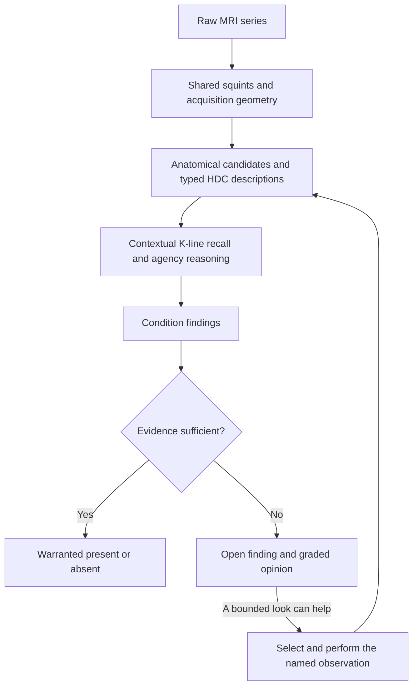

# RSNA Knee

**Computer vision built around what objects are: measure the image, recognize anatomy in context, and reason from the object to the diagnosis.**

[](https://github.com/rohanvinaik/RSNA_Knee/actions/workflows/gate.yml)
[](https://github.com/rohanvinaik/RSNA_Knee/actions/workflows/codspeed.yml)

`Anatomical reasoning · Exact HDC · Contextual K-lines · Society of Mind · Squint first`

A femur and a tibia look alike. They are both bones. A representation that finds them similar has learned something useful about bone; their arrangement across the knee joint supplies the distinction between them. Marrow belongs inside those bones. Cartilage covers their articulating surfaces. Ligaments connect them. Each object makes the next object easier to find, and each relationship gives the system another way to check what it thinks it sees.

That is the starting point of **What an \<Object> Is**, and this repository is its knee-MRI implementation. The image depicts a physical system whose parts constrain one another. Represent those parts and their relationships explicitly, and recognition becomes a succession of smaller, better-posed questions. Diagnosis follows from asking what has changed about the objects the system has recognized.

The task is concrete: read a knee MRI study and answer the twelve questions in the RSNA Knee Abnormality Detection competition. The larger experiment is whether a computer-vision system can make those answers intelligible all the way down to the observations, objects and precedents that produced them.

---

## Start with two bones

Consider a region that resembles stored femur and tibia examples almost equally. Appearance has supplied evidence of bone. The scan's acquisition geometry and the surrounding anatomy establish its role: the femur lies on the thigh side of the joint, the tibia on the lower-leg side, and the patella sits in front of the femur's distal end.

Those are connected observations. A useful partial view still contributes even when another view is missing. A conflicting view leaves a discrepancy to resolve. The anatomical map supplies the expected organization of a knee, while the actual study supplies evidence of how this knee is organized—including damage or deviation.

Once the object is established, the question changes. Is its structure intact? Is its surface preserved? Is there excess fluid in the joint? The answer depends on the object's identity, its presentation and its relationships. A bright region by itself has very little meaning. A measured signal at a known place in a known object has considerably more.

The system keeps that chain visible:

```text
observed region + measured appearance + current-study relationships
                              ↓
                      anatomical object
                              ↓
             normal or altered presentation, in context
                              ↓
              condition finding and its supporting evidence
```

A sampled window can contain several tissues. A map-proposed location remains an expectation until evidence supports it. Keeping those distinctions is what lets the same system recognize ordinary anatomy and reason about departures from it.

## Measurements become a description of one object

The pipeline reads the image through complementary **lenses**: measurements of signal, boundaries, interiors, texture and spatial relationships. Each lens reports the quantity it measures. Assigning an anatomical name or clinical meaning is a further operation, performed in context.

The thermometer is the useful analogy. Temperature is a reading. Fever is an interpretation that also requires a reference, a measurement site and a physiological claim. The representation keeps the reading and the interpretation connected, with their different scopes intact.

For the knee, one object spans the available sagittal, coronal and axial views. Its key planes retain physical coordinates, orientation and source addresses. Its description includes where a reading came from, which direction and scale it describes, and whether it was measured at all.

The HDC implementation uses a **512-row Sylvester–Hadamard carrier with exact count-space operations**. Typed banks keep the dimensions distinct; compatible counts can be bundled and compared without constructing a dense hypervector for every pixel. The exact representation preserves the encoded measurements, including their availability. A lossy measurement still has the information content of that lens.

Crucially, the full description and its cheap **squint** coexist in the same case. The cheap view can cue a rich precedent. A question that needs finer evidence can then request the relevant reading at the relevant address.

[The representation in detail → HDC_ENCODING.md](docs/HDC_ENCODING.md)

## The structure buys the efficiency

Finding anatomy and avoiding wasted computation are the same operation viewed from two sides. A bone interior narrows the marrow question. Located bones narrow the joint question. The joint and its neighbours narrow the search for cartilage, menisci and ligaments. Every useful established relationship removes work from the remaining search.

This is the efficiency thesis: **the closer the computation follows the structure of the problem, the less work it spends reconstructing information that structure already supplies.** A coarse anatomical prior can be useful long before it is a perfect boundary.

The high-resolution tools were built to resolve objects, create teaching examples and inspect difficult questions. Production begins by squinting. It recalls cases, reasons over the available anatomy and spends additional resolution only on a named question still open. Shared measurements are computed once and handed to their consumers. Each worker finishes a study, retains its required outputs and releases consumed intermediates.

The intended savings come from reducing what needs computing. Recorded kernels, memory profiles and whole-run receipts then show what the implementation actually costs. Complete-system speed and memory remain measurements to make on the deployed operation.

## Memory that remembers what the evidence meant

A **K-line** retains a contextual precedent: what was observed, the object or question it concerned, the interpretation established there, and the procedure associated with it when that is known. Full and cheap profiles remain linked to their sources.

The starting corpus is built from actual pictures. Recognizable anatomical examples are called, bundled and placed in the appropriate normal or condition-presentation buckets. The official teaching studies supply diagnosed conditions; correctly identified objects not implicated by those conditions also supply normal presentations at the scope the labels establish. Rough borders can still yield useful categorization examples.

Both signs teach. A confirmed object contributes a positive precedent. A region wrongly called femur contributes a scoped “not femur,” with the views and reason preserved. An ambiguous example remains available for inspection without becoming a negative fact.

A specialized **censor** goes further: it captures a significant difference that explains when a particular interpretation fails. Its reach follows that explanation. An ordinary negative example does not automatically authorize a universal veto.

The bootstrap loop is therefore practical:

```text
find candidates → inspect the actual images → retain signed cases
       ↑                                          ↓
       └──────── recall from the larger memory ────┘
```

Automated admission requires confident joint recognition, affirmative applicable anatomical support and no unresolved applicable contradiction. Independently warranted visual calls can teach directly. Each round reads a frozen parent and publishes a child retaining the signed evidence and lineage; the first growth round's admissions are inspected before its child is used.

[Picture pairs and teaching → GROUNDED_TEACHING.md](docs/GROUNDED_TEACHING.md) · [Review and publication → OBJECT_BOOTSTRAP_GUIDE.md](docs/OBJECT_BOOTSTRAP_GUIDE.md)

## A society of agencies, sharing one knee

Placement, identity, object state, diagnosis and the choice of what to inspect next are responsibilities within **one** Society of Mind. They share the same evolving object account. A corrected identity changes which condition questions may use that object. A new observation refreshes dependent conclusions; unrelated work stays cached.

K-lines remain active throughout this process. They help recognize an object, interpret a disagreement and recall a useful next procedure. Building the corpus makes learning possible; learning also concerns how the agencies use that corpus and their observation tools.

The implemented learned navigation layer follows three stages:

1. **Train the subject-domain specialists** over fixed HDC, recall, anatomical and availability signals.
2. **Freeze the specialists and train the orchestrator.**
3. **Refine the composed system jointly** at a lower learning rate.

This layer fits parameters over the structured representation. The lenses, anatomical definitions and exact HDC encoding retain their specified meanings. PyTorch performs training; the exported runtime uses NumPy. The current orchestrator orders existing observation requests with mandatory work first. Its numerical opinions grade open condition questions.

The resulting operation is a loop:



The learned layer is part of this existing society. Its score supplies no new anatomical fact and cannot overrule an independently warranted finding.

[Full design → CLASSICAL_AI_BUILD_DESIGN.md](docs/CLASSICAL_AI_BUILD_DESIGN.md) · [Training and runtime → SOM_NAVIGATION_RUN_GUIDE.md](docs/SOM_NAVIGATION_RUN_GUIDE.md)

## From an object to a diagnosis

Anatomy establishes physical organization. Physiology gives that organization functional meaning. A healthy reference describes an object's ordinary state; damage and disease are structured departures from it. Loss of structural integrity and excess tissue or fluid are different directions of change, measured through the lenses that can observe them.

Balanced ternary expresses those directions: **−1 below the defined reference, 0 at the reference, +1 above it**, within each dimension's meaning. Availability is separate. An unread bank, an observed normal state, a rejected identity and an absent condition each assert something different.

Each clinical question declares which tissue defines it and which tissue merely supplies context. A study-level fracture label says that a fracture is present somewhere in its scope; it does not label every bone fractured. Likewise, a whole-condition comparison has authority only over evidence it actually includes. Applicable normal and diagnosed precedents both speak.

The final output preserves the difference between a decision and an unresolved opinion:

| Finding | Emitted value | Basis |
|---|---:|---|
| Warranted present | **1** | The condition reasoning establishes it. |
| Warranted absent | **0** | The condition reasoning establishes its absence. |
| Open | Graded, strictly inside `(0, 1)` | Retained evidence and numerical opinion express remaining uncertainty. |

The shared serializer implements this policy for both ordinary and learned inference. Numerical confidence alone cannot promote an open question to a categorical finding. All twelve conditions are answered separately; conditions can coexist.

## What has been demonstrated

The [experimental notebook](docs/TRAINING_EXPERIMENTAL_NOTEBOOK.md) records each learning round with its source, memory, population, calls, corrections and resulting discrimination profile. It reports **identified / abstained / wrong per condition**, alongside the ordering of positives and negatives.

The dated checkpoint on **22 October 2026** contains:

| Component | Retained result |
|---|---|
| Signed memory | **1,061 individual cases**, with scoped identity teaching and procedure experiences. |
| Learned navigation | **16 specialist domains; 10,566,320 parameters; all three stages completed.** |
| Training population | **106 studies**, including the 58 fully labelled teaching studies. |
| Development validation | **12 separate studies**; results are mixed, and some conditions lack both truth signs. |
| Current-source raw-image check | Interrupted after **four complete study records**; no completed 58-study result. |

Saved teaching-row rankings fit the training examples strongly. The development set participated in epoch retention. Those observations answer different questions from untouched transfer, and the notebook keeps them separate. Earlier categorical errors also remain important: a strong numerical ranking cannot repair a wrong categorical premise by formatting it differently.

The software, representation, memory and first learned navigator are implemented. Diagnostic discrimination on new studies, the usefulness of learned observation choices and the final deployment envelope still need their complete experiments. Comparative or clinical performance follows from those experiments when they exist.

[The thesis and its evidence → THESIS_AND_DEMONSTRATION.md](docs/THESIS_AND_DEMONSTRATION.md) · [Three-stage pilot → experiment004](docs/experiments/training/004-three-stage-navigation-pilot.md)

## Run it

The public repository contains the code, tests and engineering documents. MRI data, signed memories, trained artifacts and private design conversations are kept separately. A fresh clone can run the synthetic tests; image inference additionally requires the supplied data and a reviewed memory. Learned inference also requires its matching exported artifact.

```sh
uv sync --locked
export PYTHONPATH="$PWD/src"
.venv/bin/python scripts/run_interiors.py --help
```

The same entry point runs local inference and the competition operation. With an explicitly selected published memory and a **new** output directory:

```sh
.venv/bin/python scripts/run_interiors.py \
  --split test --root /path/to/competition-data --workers 4 \
  --diagnostic-mode infer \
  --diagnostic-memory /path/to/reviewed-memory \
  --diagnostic-submission-template /path/to/competition-data/sample_submission.csv \
  --diagnostic-output /path/to/new/inference
```

Add `--diagnostic-navigation /path/to/compatible-navigation-artifact` to use the trained layer. The [navigation guide](docs/SOM_NAVIGATION_RUN_GUIDE.md) gives verified artifact selection, dataset preparation, training, resume and runtime commands. The [squint run guide](docs/SQUINT_RUN_GUIDE.md) covers compilation, review, immutable growth rounds, retained evidence and deployment. Outputs preserve source addresses, compared cases, findings, unresolved questions and the official twelve-column template.

High-resolution development and optional drawing use the same entry point. [OBJECT_OUTPUT.md](docs/OBJECT_OUTPUT.md) describes retained pixel bundles and provenance; [RESOLVING_THE_PARTS.md](docs/RESOLVING_THE_PARTS.md) describes how the anatomical tools resolve each part. Drawing is off by default and excluded from production work.

### Verify the complete source

```sh
uv sync --locked --extra som-training
bash scripts/ci_local.sh
```

The training extra makes the trainer tests run too. The declared gate checks tests and coverage, formatting, workflow security, import boundaries and Sonar correctness. Vulture, type findings and recorded-kernel performance remain visible as engineering leads. The quality pass preceding this README revision passed **6,187 tests** with **zero open Sonar bugs or vulnerabilities**; [its record](docs/work/reviews/QUALITY_PASS_20261022.md) retains the repairs and remaining performance leads.

Sonar uses Docker. It can be stopped after verification; keeping the project open does not require keeping its analysis VM running. A successful software gate establishes its stated contracts. The clinical and whole-system experiments remain separately recorded.

### Competition deployment

The offline package must fit the competition's nine-hour limit and its CPU, RAM and storage envelope. [FULL_BUILD_PLAN §16.9](docs/FULL_BUILD_PLAN.md#169-competition-resource-envelope-w8b-storage-closure-and-w10-verification) owns the deployment requirements: storage closure, complete-operation measurements and a separate account of hidden-scale projections. Current packages must be rebuilt and pinned to the selected source, memory and navigation artifact before deployment. Formal submission requires the author's explicit permission.

## Read the project

| Question | Start here |
|---|---|
| What is the theory? | [THEORY_OF_THE_CASE](docs/THEORY_OF_THE_CASE.md) and [the thesis account](docs/THESIS_AND_DEMONSTRATION.md) |
| How do anatomy and diagnosis connect? | [RELATIVE_POSITION_MAP](docs/RELATIVE_POSITION_MAP.md), [OBJECTS_AND_CONDITIONS](docs/OBJECTS_AND_CONDITIONS.md), [AI_DIAGNOSTIC_DESIGN](docs/AI_DIAGNOSTIC_DESIGN.md) |
| What does the representation preserve? | [HDC_ENCODING](docs/HDC_ENCODING.md) |
| How do cases become an active AI system? | [CLASSICAL_AI_BUILD_DESIGN](docs/CLASSICAL_AI_BUILD_DESIGN.md) and [training execution](docs/CLASSICAL_AI_TRAINING_EXECUTION.md) |
| How do I run, inspect or teach it? | [SQUINT_RUN_GUIDE](docs/SQUINT_RUN_GUIDE.md), [OBJECT_BOOTSTRAP_GUIDE](docs/OBJECT_BOOTSTRAP_GUIDE.md), [SOM_NAVIGATION_RUN_GUIDE](docs/SOM_NAVIGATION_RUN_GUIDE.md) |
| What did each experiment establish? | [TRAINING_EXPERIMENTAL_NOTEBOOK](docs/TRAINING_EXPERIMENTAL_NOTEBOOK.md) |
| Where should a new contributor resume? | [FULL_BUILD_PLAN §13](docs/FULL_BUILD_PLAN.md#13-context-stable-continuation-and-stop-points), its sole [current packet](docs/work/current/README.md), and [AGENTS.md](AGENTS.md) |

Application development is paused at the author's request. The current packet owns the continuation; commands in this README describe available operations and do not queue new training or a submission. `archive/` and `archive2/` remain outside the active build.

---

Rohan Vinaik · Computer vision as reasoning about a structured world.
