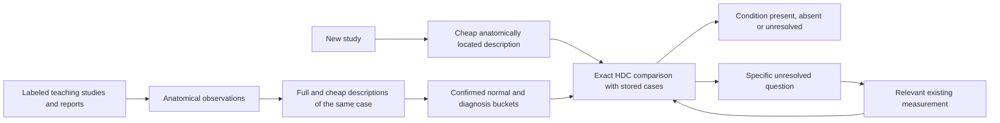

# Diagnostic memory from anatomical object profiles

Design contracts, 2026-10-20. This specifies the AI continuation requested in the
[third conversation](conversations/2026-10-20-classical-ai-diagnostic-control.md),
especially its final exchange. Section 14 maps these contracts to the engineering interfaces;
the active task packet records their verification and remaining work.
The existing `FULL_BUILD_PLAN.md` remains the master build plan; its §13 points to the
sole live task packet. This document supplies the P13 contracts and preserves the separately
unsettled inputs in §12.

Rohan's correction governs: **the central operation is constructing and recalling a
store of normal and diagnosed anatomical cases.** Describing the AI principally as a
scheduler that decides how much of the anatomy pipeline to run misses the mechanism.
The representation makes recognition by precedent possible; the work avoided follows
from that recognition.

**Build sequence clarified by Rohan:** establish the seed images and object bundles;
build functional K-line memory and recall; use those examples for the first recognition
and normal-versus-disease capacity test; then expand into mass training. The seed
packet is the basis of that test, not a claim that diagnosis already works before the
AI layer exists. His two complete clarifications are in the third conversation.

## 1. Mechanism and source

Anatomical rules and lenses produce typed observations. Their exact HDC encoding makes
observations at different scales and views comparable. A confirmed example joins an
answer bucket as a complete case. Its bundle cues that answer's K-line. A new study's
description is compared with those cases over the banks relevant to the question.
The recalled interpretation can answer the diagnostic question or call a particular
existing tool where more evidence is needed.

The human now specifies the knee's questions: normal and diagnosed versions of each
relevant object, and combinations of objects bearing on the twelve conditions.
The cell thesis supplies the memory mechanics, not a requirement to copy cell labels,
temporal anchors, spatial bins or microscopy calibration into MRI.

| Source unit in *What an <Object> Is* | Contract carried into this design |
|---|---|
| §§1.6–1.7 | Named measurements, exact codes, interactions, confirmed expectations and departures; no self-confirmation |
| §§7.1–7.7 | One profile across scales; full/cheap paired readings; silence; question-selected banks; exact differences |
| §§8.1–8.7 | Whole contextual cases in answer buckets, K-lines, calls, censors and near misses |
| §§9.1–9.4 | Independent teaching calls, clear initial examples, hard-case teaching, complete provenance |
| §§11.1–11.5 | Separate questions/oracles, concurrence, disagreement and abstention, learning trajectories |
| §§13.1–13.7 | Exact count/vector equivalence, integer comparisons, running sums, reuse and compiled reference twins |
| §§14.1–14.2 | Domain laws, lenses and teaching instantiate the same architecture |

Primary source:
`../cell_tracking/docs/pipeline_thesis/paper/what_an_object_is.md`.
The lead personally read these complete units or their complete relevant subsections;
the worker's source inventory is supporting evidence, not a substitute for that reading.

Rohan corrected the additional think-through sources to
[K_LINES.md](../../cell_tracking/docs/K_LINES.md) and
[HDC_DESIGN.md](../../cell_tracking/docs/HDC_DESIGN.md). The lead read both whole.
They specify individual case memory, signed calls per question, context in both the
profile and its indexing, paired full/cheap descriptions, and reuse of retained
observations. Their cell-specific dimensions, timing and historical defaults are examples.
Explicit corrections in those documents govern over their remaining stale sentences
about class bundles or leaving rejected places entirely unwritten.

## 2. The two operations

Teaching can spend substantial computation to expose and encode what is present.
Inference should pay for the small description that the question requires. Resolving
every object and every border remains an available capability, not a mandatory
precondition for every diagnostic answer. Memory never supplies an unobserved reading:
it supplies a warranted interpretation of the readings actually available.

## 3. What the 58 studies teach

The current local `train.csv` contains 4,407 studies. Exactly 58 have all twelve binary
labels populated; the other 4,349 have all twelve blank. All 58 have reports. The lead
independently recomputed these counts. The detailed source audit is
`data/readings/ai-diagnostic-design-20261020/label-facts.md`.

| Question | Positive cases available | Negative cases available |
|---|---:|---:|
| ACL | 24 | 34 |
| MCL | 9 | 49 |
| Medial Meniscus | 26 | 32 |
| Lateral Meniscus | 23 | 35 |
| Medial OA | 15 | 43 |
| Lateral OA | 11 | 47 |
| PF OA | 21 | 37 |
| Effusion | 35 | 23 |
| Synovitis | 27 | 31 |
| Baker's | 12 | 46 |
| Contusion | 19 | 39 |
| Fracture | 18 | 40 |

These are teaching labels available, not counts of already encoded or accepted cases.
There are 696 study/condition calls, with shared image descriptions rather than 696
independently stored copies of the images.

A study with an ACL injury can still supply a negative example for another condition.
No study is negative on all twelve labels; this does not prevent constructing the
normal/negative buckets object by object and question by question.

Keep the scope of the call with the case:

- A study's `ACL=0` supplies a negative call for ACL injury. It need not claim that
  every tissue or every possible attribute of its ACL is healthy.
- `Fracture=1` teaches the bone-family diagnostic case. It does not label every
  constituent bone or pixel fractured. A report or independent visual call that
  identifies a particular bone can additionally teach that narrower case.
- A positive label with no object-specific localization is usable at its declared
  composite scope. Do not demand pixel annotations before allowing it into that store.
- Object-normal calls stronger than a condition-negative label retain the report,
  source statement or independent visual call that establishes them.
- Blank labels, unobserved objects and failed recognition do not become negatives.
  Reports are teaching evidence; they are absent from the inference inputs.

The case builder can start with the 58 labeled studies. Report-derived additional calls
are a separate, attributed teaching source; neither automatic report interpretation nor
the memory's own answers silently promote themselves to ground truth.

## 4. What is stored

### Canonical object description

Reuse one object's existing combined HDC profile across its views, lenses, directions
and measured scales. Keep its original places and readings addressable. A missing view
is a missing contribution, not a different object or an assertion of normality.

Each description records its measurement mode and scope. A cheap anatomical region,
a resolved object mask and a local subregion are different scopes. They can belong to
the same canonical object's record without claiming identical pixels.

### Case

One case contains:

1. Its typed subject: an object, subregion, or role-preserving anatomical combination.
2. The full and/or cheap count profiles and their compatible carrier, layout,
   reference, acquisition and scope identities.
3. A map of calls by question: +1, −1, or silence, with the subject and independent
   source for each call. Keep it separately from the observed profile so a diagnosis
   label cannot become an input feature.
4. The expected interpretation and any independently confirmed departure.
5. Its source study, series, slices, addressed support, original values, teacher,
   verbatim report/call where applicable, and teaching revision.
6. Any recalled procedure and confirmed near-miss links.

One answer word must not replace that map. “Abnormal, condition unspecified” supplies
no call on a particular condition; an explicit “not torn” supplies a negative call on
tearing. Neither statement establishes that the whole object is healthy. Preserve
recorded abstentions with the teacher's words in the teaching ledger, distinguish them
from questions never asked, and teach neither as a positive or negative case.

Retain the original values and source addresses needed to re-encode the case when a
reference or layout declaration changes. The new encoding gets a new identity beside
the old one; changing a reference must not require repeating recognition when its
readings are already retained. Carrier, layout and reference compatibility is checked
before comparison, never repaired by renaming an identity.

In these count exports, an omitted bank or an all-zero count row supplies no observation.
A measured value at its declared ternary middle still occupies a code row and is a
reading. Store admission must preserve this distinction; zero-filled storage cannot
become evidence of a healthy object.

The same underlying profile may be referenced by several answer buckets. Cases remain
individual. Bundling all cases into one mean or sum would destroy which readings occurred
together in a particular example (§8.1). Bundling places into an object and objects into
a typed case remains valid.

### Buckets and K-lines

Each question has positive and negative answer buckets, with whole confirmed cases as
cues. Unknown calls do not teach either side. A genuinely normal anatomical case may
support several questions, but a negative on one question is not automatically copied
to all others.

The bucket index is small metadata over shared exact profiles. Study IDs, reports and
labels belong to provenance and teaching, never to image-resemblance banks.

Keep answer grouping and contextual indexing distinct. Context can select compatible
cases and can itself be a measured facet relevant to the question: the local tissue,
its neighbours and its wider anatomical setting are part of the profile. Do not strip
all context from comparison or replace local observations with a study-level category.
Each question declares its compared facets and compatibility conditions. Any context
hierarchy and parent fallback must be declared, retain the actual contextual readings,
and preserve acquisition/reference/mode compatibility; fallback does not pool cases.
Cell plate categories and their historical fallback order are not knee defaults.

The memory is organized for every anatomical object in the project's catalogue,
including objects used as context and objects without their own competition label.
The twelve condition questions are its first consumers, not twelve isolated object
stores. Inventory each object's normal and injured/diseased precedents and the
combinations that have teaching support. An empty bucket records a coverage gap;
absence of a condition label or of an observed object never populates a normal bucket.
Broader report calls keep their broader scope rather than being copied as individual
pixel or tissue diagnoses. This allows useful cases to enter immediately without
inventing unsupported state labels for every structure in a study.

The coverage index records object × taught state × question, with subject scope and
source attached. A contextual object reference is not a taught normal/disease state.

The K-line record links its case cues to the interpretation, expected/departed state,
and any relevant procedure. Retrieving a compatible cue can supply the diagnostic
interpretation directly. It does not merely select which reconstruction function to run.
An independently confirmed negative case belongs to the negative answer bucket; it is
not automatically a learned near-miss censor. Those have different origins and effects.

The thesis also calls a confirmed negative digit a **remembered censor** (§8.5).
Preserve that meaning: it speaks against the addressed interpretation. The special
recall veto belongs to a censor written from a confirmed near miss, within its trust
radius. Do not implement every negative case as an unconditional veto, or omit negative
cases from concurrence because they are not near misses.

## 5. Object combinations and interactions

Objects retain their anatomical roles inside a combination. A medial compartment case
can contain its femoral surface, tibial surface, cartilage and meniscus. Adding all their
counts in the same unqualified banks would lose which object supplied a reading.

Proposed exact construction: a deterministic, versioned role qualification of existing
facet addresses in the case composer, plus separately named measured relation banks.
The composer refers to the canonical objects' existing facets and preserves their original
rows. Its inverse names the object, view, scale, direction and reading.

Role qualification alone does not encode every interaction. Two cases can have the same
marginal counts and different arrangements or relationships. The thesis explicitly says
an interaction needs a code for the combination itself (§1.6). Where a diagnostic
question concerns a relationship, write the measured relationship or local joint state
in its own bank. Do not call an ordinary sum a logical AND.

Authored anatomy defines which relationships to ask about. A sourced statement that
fluid belongs between particular neighbours is not itself an observed finding in the
current study. Definition-context rows therefore do not vote as measured evidence.

Keep a physical impossibility distinct from departure from the healthy ideal.
A damaged object's disrupted continuity, enlarged extent or altered relationship can be
the evidence sought. Do not use its healthy definition as a censor that removes that
evidence or refuses to encode the object because it is abnormal. Identity, expected
state and observed departure remain connected in the same case, as Rohan specified.

## 6. Twelve question contracts, sharing objects and measurements

The anatomical roles below follow `OBJECTS_AND_CONDITIONS.md` §§4–6. This is the proposed
organization of the question declarations, not a claim that every diagnostic feature
producer is installed. Each declaration must bind actual measured banks before it runs.

| Question | Subject of its cases | Relationships/readings the question concerns |
|---|---|---|
| ACL | ACL with its femoral/tibial attachment context | Course, continuity, internal and surrounding sequence-specific appearance |
| MCL | Superficial/deep MCL and medial attachment context | Continuity, local appearance and surrounding tissue in the medial course |
| Medial Meniscus | Medial meniscus, retaining regional and compartment context | Its substance, shape and signal relationships at the relevant locations |
| Lateral Meniscus | Lateral meniscus with lateral context | The corresponding lateral readings, with its own anatomy preserved |
| Medial OA | Medial articular compartment | Opposing surfaces, cartilage, meniscus, joint relationship and subchondral bone |
| Lateral OA | Lateral articular compartment | Corresponding lateral roles and relationships |
| PF OA | Patella–trochlea articular compartment | Opposing cartilage and bone surfaces and their relationship |
| Effusion | Joint cavity and recesses | Fluid appearance and extent within the anatomically located spaces |
| Synovitis | Lining with adjacent joint contents | Lining-specific appearance and relation to fluid; preserve acquisition limits |
| Baker's | Posteromedial bursa and neighbouring structures | Fluid and its location relative to semimembranosus, gastrocnemius and joint |
| Contusion | Bone/marrow family; individual bone where source localizes | Intra-bone sequence-specific appearance, retaining location and bone role |
| Fracture | Bone family; individual bone where source localizes | Bone structure and continuity with its surrounding appearance |

All twelve questions may be active together. Several positive conditions can coexist.
Concurrence applies within a question; one positive diagnosis never suppresses another
merely because the outputs were packaged together.

The question fixes its relevant banks from anatomy before the run being judged. There
are no fitted bank weights and no search for the subset that maximizes label separation.
Acquisition words establish compatibility/context, not evidence that an injury is present.
Scope/status words describe the observation; they cannot substitute for its contents.

For effusion and Baker's, the subject includes the anatomically located cavity, recess
or posteromedial region, including when no distended fluid object is resolved. An
inspected region with a measured fluid reading can supply evidence; failure to produce
a fluid/bursa candidate cannot. Bind the region, inspected support, acquisition and
actual reading in the declaration. This does not install a diagnostic absence threshold.

## 7. The representation work still required

### Author clarification: structured resemblance, not literal pixel matching

Rohan's complete clarification is preserved in the third foundational conversation.
He directs clinical reference work and reading
`/Users/rohanvinaik/Projects/rohan-vinaik.github.io/papers/Core Documents/AI_architecture_papers/law_as_architecture.md`
alongside the object thesis, and emphasizes: «It is NOT brittle and literal pixel
cosine match». The exact carrier is exact about the named readings it stores. It does
not turn the case into a pixel template or require a new image to reproduce one case's
coordinates, outline or raw signal values.

The remembered configuration carries anatomical identity, its measured relationships,
view, direction, scale and acquisition context. Resemblance recalls the interpretation
of such a configuration, including a confirmed departure from the expected object.
The law paper makes meaningful structure and context-bound reconstructive memory
load-bearing; its geosteering coefficient blending is not a replacement for the object
thesis's diagnostic concurrence. Healthy expectations must not censor away the pathology
that the question asks about.

Rohan asks that warrant be worked through by visual reasoning and discussion. Begin
with actual normal/diagnosed images, the readings each bank expresses, and the named
differences. Asking him for an arbitrary cosine cutoff, or treating an unspecified
numeric reference as a reason to halt every independent engineering lane, misses that
instruction. The source-backed clinical meanings, the measurement encoding reference,
and the independent teaching call retain their separate scopes. A reference is not
always a universal scalar healthy range.

### Existing carrier and remaining bindings

The exact carrier, per-place rows, count addition/subtraction, joint-bank cosine terms,
exact comparison ordering, object composition and persistent readback already exist.
The reference production path encodes retained recognition outputs; the diagnostic branch
in §14 consumes those outputs or explicitly acquired cheap profiles for case recall.
The encoding modules are `knee.encoding.counts`, `carrier`,
`places`, `composition`, `object_profile`, `operation` and `product`.

The present built-in declaration intentionally supplies no numeric references.
`make_mri_spec` explicitly leaves its reference lists empty. Acquired signal, distance,
area and other retained numeric readings therefore can remain `missing_reference` rather
than write diagnostic digits. Boolean low-signal and other declared words can already
write real rows. The audit records which distinction appears in an existing product:
`data/readings/ai-diagnostic-design-20261020/encoding-facts.md`.

This is a specific integration dependency, not grounds to rebuild the anatomy machinery.
For every bank a question will read, bind:

- the actual producer, quantity, units, acquisition, place and scale;
- its reference meaning and source;
- its measured words or ternary comparison, including what a middle means;
- its cheap/full source modes and compatibility;
- the question that consumes it and the relevant normal/diagnosed cases.

Clinical normality, a measurement's encoding reference and a case's diagnosis label
must retain their meanings. A normal example can be a precedent without establishing a
universal raw MRI intensity. The knee's healthy-reference conversation governs; cell
terciles are not an authorized replacement.

Begin with the meaningful structural/qualitative banks that can already speak. Add
numeric references only under their actual measurement contracts. If the normal case
store is to provide an empirical reference for a particular lens, explicitly specify its
eligible cases, reference construction and frozen identity; do not smuggle in a cohort
percentile or an injury-separating cutoff.

The current compatibility implementation includes the actual typed reference bounds,
their source and units in the count-layout identity. Giving two scans the same
`reference_id` with different bounds does not make them comparable. Independently
computed per-scan terciles would therefore require a newly specified calibration and
comparison contract; they are neither an installed capability nor a drop-in repair.
If a scan-derived calibration produces a quantity with common semantics, declare that
quantity, its provenance and its common reference explicitly. Do not remove identity
checks to conceal changed meanings.

The memory schema, storage, exact retrieval and teaching ledger can be implemented
while those bindings are completed per question. Do not turn a missing numeric reference
into a requirement for a complete quantitative healthy-MRI atlas before any useful
case is stored or compared. Conversely, a successful lookup over the banks already
available does not certify the omitted distinctions for all twelve questions.

Two representational checks are essential to the intended question:

1. Cosine is unchanged if every count in one profile is multiplied by the same positive
   factor. If extent matters, encode the relevant measured extent or spatial distribution;
   duplicated pixel counts alone do not encode “larger” for cosine.
2. Matching a scanner/view/status bank is not matching damaged or normal tissue.
   Inspect the actual image-content rows and decoded differences of real paired cases.

These checks examine what the encoding says, not whether masks are perfect.

## 8. Recall and named outcomes

For a question's declared banks, compare the query with each eligible stored case using
the existing count arithmetic. If count vectors are `c` and `d`, the vector dot and both
squared norms are the corresponding count terms multiplied by 512. The common factor
cancels. No dense per-pixel hypervector is needed.

Use one cosine over all selected banks that both sides speak. Omit a silent bank from
the dot and both norms. Preserve the compared bank set and evidence scope with each
result. Different layouts/references or incompatible source modes are named incompatibilities.
An exact ordering is available by cross-multiplying squared integer terms.

The thesis separates nearest-case proposals from warranted recall:

1. Nearest positive/negative cases can produce a proposal and a teaching sheet.
2. Cases reaching their justified trust radius speak; confirmed near-miss censors
   veto only the interpretation they address.
3. A single surviving answer is recalled. Contradictory answers remain a disagreement.
   If no case speaks, the result is an abstention.

Every eligible case within its trust radius speaks. A farther opposing case does not
stop speaking merely because a nearer case supports the proposed answer, even within
one view or anatomical family. A nearest-case or majority rule cannot silently replace
this contract. Confirmed censors may defeat their addressed interpretation; an ordinary
opposing case is not discarded as a convenience.

The thesis derives trust from chance resemblance on real data, not an arbitrary universal
cosine cutoff. Its exact null construction and acceptance convention for MRI still need
to be specified; no guessed numeric threshold is authorized by this proposal.

The chance experiment must match the claim it warrants. Resemblance to unrelated
objects can test anatomical identity; it does not by itself establish a meaningful
distinction between normal and damaged instances of the same object. Preserve the
null population, compared bank/availability scope, teaching split and exact comparison
record. Do not tune a radius to remove inconvenient contradictory labels.

Keep at least `present`, `absent`, `unresolved_no_precedent`,
`unresolved_conflict`, `unresolved_missing_reading` and `incompatible_encoding` as
distinct results. The last four are zero on the diagnostic call, with distinct remedies.
Failure to match a positive case never supplies the negative call by itself.

Questions can ask for another view, a local relationship or a specific retained measurement
when needed. That is a consequence of their unresolved evidence, not a command to run the
entire anatomy pipeline after every memory query.

Use compatible readings already retained before requesting new computation. A successful
recall can return the diagnostic interpretation directly; it does not require an automatic
structural rerun beside it. The cell clean-up's nearest-attractor/repulsor operation is a
different consumer of the same memory. It does not replace diagnostic concurrence.

## 9. Cheap recognition without circular full reconstruction

Store paired full and cheap descriptions while teaching. The cheap description must be
produced by the same input-available procedure that inference will use. A teaching mask
may establish the full object's source, but inference cannot secretly require that mask
before it constructs the supposedly cheap cue.

Proposed MRI binding: use existing squint readings, anatomical anchors and the common
map to identify useful regions and views; encode the actually observed raw/coarse
readings there under their explicit scope. A region need not be a perfect boundary.
Cheap and full descriptions remain associated with the same case and object, with their
source distinctions retained (§7.4).

Keep the pair's relation inspectable, as the thesis's calibration does: identify the
two supports and source states, their context, the banks each writes, and the observed
agreements, differences and silences. This is a recorded relationship between descriptions,
not a fitted transformation or permission to compare incompatible modes. It can be built
alongside the store from the paired producers and shown on a bank-by-bank evidence page.

A full profile and a cheap profile are not automatically interchangeable just because
some bank names match. Compare cheap to the compatible cheap stored descriptions;
use the paired full case to retain the confirmed interpretation and richer explanation.
Where a quantity is truly identical across modes, its declared common semantics permit
reuse. Missing expensive banks remain silent.

Before storing cheap descriptions, pin their actual producer list, dependency order and
composition mode. The full map may require bone work that the earliest squint does not.
A query made before that map exists must leave unavailable directional facets silent,
and its stored cheap counterparts must use the same procedure. A later anchor-assisted
description is a separately declared mode. No worker may call a description cheap while
silently sourcing it from the completed full reconstruction.

Object key slices are useful starting places. A diagnostic feature can occur away from
an object's most representative section. The cheap slice information already available
must be allowed to point to that feature; a negative answer cannot mean “the canonical
slice looked ordinary, so the uninspected rest is normal.”

Running sums, reuse of coarse rows, exact bounds and sparse profiles make this lookup
cheap. Use actual irregular supports or explicitly declared coarse regions, not a padded
rectangle mislabeled as an object. Packed signs can order a search, but may eliminate
a case only when an exact bound warrants it (§13.1–13.3).

### Cheap observations beyond accepted object supports

HDC_DESIGN §2.1 explicitly corrects the earlier rule that a place rejected by a full lens
writes nothing. The sparse route keeps cheap raw observations and any applicable
residual readings. For the knee, a failed object rule or an unclaimed part of an inspected
anatomical region must not silently remove its available cheap evidence from the memory's
view. Encode that evidence under its actual region and source scope; it may remain
unassigned to a named object. A leg/search prior bounds work without asserting that
uninspected places are normal or empty.

The cheap-mode declaration must name which regions it inspects, which readings it writes
there, and what remains unavailable. Preserve the coarse exclusion findings and source
addresses needed to revisit an unresolved region. This is targeted sparse access, not a
requirement to allocate full profiles or run full lenses over every voxel. Effusion,
bursa and marrow questions must be able to read their located regions even when an
upstream object mask is missing or incomplete.

### Shared readings and exact reuse

Store a shared neighbourhood, view or study reading once for its actual dependency
state, with references from the places and objects that use it. Cache identity includes
the producer, source state, scope, layout/reference and measurement mode. Subtract an
object's contribution only from a bundle containing that same contribution; recompute
only affected dependencies when the underlying state changes. A changed support can
also change its contextual readings.

Do not allocate a full bank-by-carrier table for every pixel. Per-place codes and shared
context accumulate into the count tables the current question needs. Running sums serve
repeated overlapping region queries; ordinary case recall uses the existing count terms.
Reuse across studies concerns immutable declarations and memory; measured context is
reused only when its actual source/dependency identity is the same.

## 10. Teaching, near misses and the competition readout

The first store preserves all eligible independent calls, with uncertain localization
kept at its proper subject scope. Teaching revisions are immutable; a later corrected
call stands beside the earlier one. Show paired normal/diagnosed cases with their
native images, relevant banks and decoded differences. This is the direct visual test
that the representation actually exposes what the question concerns.

Inspect held-out studies with all their views and regions excluded from memory.
Where stronger patient linkage exists, keep that group together too. Report present,
absent, abstained and wrong per condition, with the cases each answer recalled.
Duplicates and repeat views of one study are not independent confirmations.

A confirmed erroneous recall can produce a near miss. The exact difference names
what changed; an independent call establishes that the previous answer was wrong.
Then the thesis permits a censor, a split K-line, or no new claim. A refusal alone
never writes a censor. Keep the memory fixed while reading a study; its own diagnosis
does not teach it.

Competition output requires twelve graded values per study. This must be a separate,
explicit readout of the recall evidence, not a silent conversion of “unsure” into
“healthy,” nor a fitted classifier attached by default. Preserve nearest supporting
and opposing precedents, exact comparison terms, coverage, conflicts and the internal
call so the final readout can be specified without rebuilding memory.

Rohan settled the readout's governing distinction in §16: warranted symbolic answers
emit 1/0; uncertainty uses graded HDC evidence. The versioned MVP policy below implements
that distinction without making a calibrated clinical-probability claim.

One consult proposal is to order results by internal verdict class, then by the exact
difference between the nearest positive and negative squared cosines. This is a
candidate export policy, not a thesis requirement or an adopted decision rule. Its
handling of silence, unequal evidence coverage and conflicting cases must be explicit.
Any final numeric serialization leaves the internal unresolved states and their
evidence intact and is never fed back as a teaching call.

## 11. Parallel implementation contracts

Independent mechanical lanes can write code concurrently against shared frozen schemas;
only the work that consumes an unsettled reference, trust or readout contract waits for
that particular decision. These are implementation contracts; current jobs and acceptance
are recorded only in the active task packet. The lead owns schema meaning and the real entry point.
Use native helpers and Claude Max workers with complete source units, bounded ownership,
isolated outputs and the existing worker guide. No lane substitutes a local score target.

| Lane | Reads → produces | Real consumer / intent checks |
|---|---|---|
| Case store | Existing object products and confirmed calls → immutable cases, bucket indexes and provenance | Recall; no pooling cases, no label in the cue, no blank-to-negative conversion |
| Question/layout declarations | Anatomy, current producers and accepted reference contracts → role/bank/relationship registry | Case composer and query encoder; role swap and interaction distinctions survive |
| Cheap paired descriptions | Teaching studies and input-available squint/map → compatible cheap case/query bundles | Recall; no test label, full-mask or full-reconstruction dependency |
| Exact retrieval | Compatible counts and selected banks → proposals, speaking cases, named recall/conflict/silence | Condition agencies; exact reference agreement, missing-bank and tie cases |
| Teaching/evidence | Labels, reports, calls and case sources → scope-aware teaching ledger and visual case comparisons | Store admission and near-miss review; no self-teaching or same-study evaluation |
| Production integration | Existing study loader, cheap encoder, memory, bounded existing measurements → twelve diagnostic records and agreed readout | Actual `scripts/run_interiors.py` route; no parallel orphan diagnosis script |
| Independent verification/performance | Frozen interfaces and integrated run → intent evidence and whole-operation costs | Lead acceptance; exactness, actual producer use, bounded memory, work avoided |

### Reuse boundary with the cell implementation

The cell documents specify the intended behavior; historical code is not its substitute.
The source check found that `cell_tracking.cassette.stores.recall` still determines
which answer speaks from `KindLine.bundle`, the sum of its cases. It records individual
matches separately. The lead personally checked the whole relevant definitions:
[interface check](../data/readings/ai-diagnostic-design-20261020/memory-design-sources-review/root-interface-check.md).
Do not port that aggregate answer test. Individual eligible cases must determine the
knee recall evidence. Its query also needs the explicit encoding compatibility already
required here; a matching ndarray shape and a form string are insufficient.

The [cell interface inventory](../data/readings/ai-diagnostic-design-20261020/memory-design-sources-review/cell-interfaces.md)
locates arithmetic, case storage and window operations that may be reused after checking
their contracts. Their existence is not evidence of a connected production caller.
The current knee carrier and product interfaces remain the integration substrate.

The practical order is contracts first, then concurrent store/encoder/retrieval/evidence
work, then integrated teaching and held-out inference. The first end-to-end example
should connect a real normal/diagnosed case pair to a different study's query, show the
decoded image evidence, and emit the diagnosis record through the production entry point.
The same machinery extends across the twelve question declarations; it is not twelve
independent systems.

### Ordered delivery and the first capacity test

| Stage | Concrete output | Completion evidence |
|---|---|---|
| Seed basis | One source-backed positive and negative image/bundle case per competition question, plus a catalogue-wide object/bucket coverage index | Actual source images, retained measurements, invertible bundles and independent teaching calls; missing connections named |
| Functional AI layer | Shared case store, question declarations, compatible cheap cues, exact retrieval and K-line interpretation through the existing production command | A cue made from image observations reaches its stored precedent and interpretation; labels and study IDs do not enter resemblance |
| First capacity test | Run actual image cues through that functional path, showing nearest proposed normal/diagnosed precedents and their measured distinctions; report warranted recall where its trust contract is established | Report proposals separately from recognized, unresolved and wrong per question; a stored case recalling itself tests wiring only, while a study excluded from memory tests transfer |
| Mass training | Expand the same case/bucket machinery over the available independently labeled or otherwise independently taught examples, then near-miss teaching | Frozen teaching revisions, whole-study separation for evaluation, retained calls and censors, and explicit remaining coverage |

The first capacity test need not wait for perfect boundaries or full clinical accuracy.
It must exercise the intended recognition mechanism on actual measurements. Where a
distinction has not reached the encoded banks, connect that producer to its proper
bank; where compatible cases disagree, retain the disagreement. Neither issue licenses
changing the object definition to separate these particular labels. Mechanical store,
retrieval, hardware and production wiring proceed in parallel while individual
measurement bindings are completed. Mass training expands this functioning substrate;
it is not a substitute for missing representation or an unconnected recall path.

Self-comparison is permitted only as an explicit wiring test, never as a teaching or
recognition result (§9.4). A small, separately recorded teaching/reference split may
establish the MRI trust contract before the first warranted recall test. A single seed
on each side does not establish that contract. This bounded preparation is distinct
from mass training and must not reverse Rohan's requested order.

The integration seam must precede `_measure_and_encode_competition_at`'s unconditional
`measure_study_at` call. A memory consumer appended only after full measurement would
implement the expensive teaching/reference route, not the intended cheap inference
route. Keep both as explicit modes of the existing command. The inference mode shares
study loading and cheap context, constructs the query, recalls, and requests only the
existing producers needed for unresolved questions. A producer already run for one
question supplies every other consumer. A mode that merely returns cached diagnoses
by study ID is not recognition.

Until individual fallback producers are callable through this graph, an unresolved query
may explicitly use the existing full route. Record that fallback and its entire cost;
do not count it as cheap inference. This permits an early integrated path without
disguising the remaining work on targeted computation.

Pin intent through the required Detective setup/two-sign process before code changes.
Particularly important counterexamples: swapped anatomical roles; same marginals but
different relationships; twice-as-large proportional profiles; silent versus normal;
contradictory cases; one study teaching several diagnoses; and a cheap query trying to
load unavailable full masks.

Share the case store read-only across bounded study workers where the runtime permits.
Decode each needed image once, share its readings across questions, and release per-study
working state after the diagnosis and required provenance are published. Do not run drawing
in competition mode. Measure the entire diagnostic operation against the existing offline
competition envelope, including memory loading, input decoding, fallback work and output.
Do not infer its runtime from isolated cosine benchmarks.

Apply Rohan's existing retention decision: keep complete object outputs, measured values
and necessary provenance that the chosen route produces; release consumed intermediate
files and per-study working state. An inference record also retains its cue, compared
bank set, precedents, interpretation and fallback history. Do not run otherwise unneeded
reconstruction just to populate absent full-output fields. If deployment later requires
discarding retained object outputs, that is a separate change to this contract.

## 12. Decisions still to settle, without reopening the thesis

1. The concrete MRI bank/reference declarations for diagnostic image content, including
   any empirical normal-reference construction and its comparison identity.
2. The MRI chance-resemblance/trust-radius construction used for warranted recall.
3. The governing competition readout distinction is now settled in §16; future changes to
   its graded confidence construction remain explicit and versioned.

These are bounded parts of the requested design. They do not change the central mechanism:
normal and diagnosed cases supply the K-line memory; compatible HDC comparison performs
recognition; anatomical structure determines what the description means and what work remains.

The latest human answer sets how to resolve them: clinical sources and visual discussion,
grounded in the complete law paper and relevant object-thesis units. It does not authorize
literal pixel matching or a guessed numerical decision policy. Inspect a real configuration
and its decoded distinction before formulating any remaining custom-design question.

## 13. Independent consultation and reconciliation

Fable was consulted at maximum effort through the authenticated Claude Max subscription,
with the literal human prompts and complete thesis included. The receipt identifies
`claude-fable-5-1`. Its raw final text starts midway through a sentence before section 4;
the returned sections were read in full, but no missing opening is claimed as reviewed.
The process's successful exit does not establish response completeness.

The [consult reconciliation](../data/readings/ai-diagnostic-design-20261020/fable-reconciliation.md)
records source checks, actual model/route, and which suggestions remain unadopted.
In particular, this design does not substitute nearest-case diagnosis for concurrence,
install per-scan terciles as healthy references, or assume that cross-object resemblance
alone warrants normal-versus-damaged state recognition. The complete raw return and
metadata remain beside that note. The primary conversations and thesis govern.

### Final-plan review through Claude Max

The separate requested final-plan review completed on 2026-10-20 through the same
subscription route, using `claude-fable-5-1` at maximum effort. Its complete answer has
both requested boundary markers and a normal end-of-turn receipt. The lead read it
whole and checked the recall/censor/teaching distinctions against thesis §§8–9.

Fable's conclusion was **“compatible with listed repairs.”** The
[final reconciliation](../data/readings/ai-diagnostic-design-20261020/final-plan-review/reconciliation.md)
records each disposition. The plan now makes encoding versioning/re-encoding, count
silence, cheap-mode dependencies, scoped negatives and the first-test terminology
explicit. It preserves the requested sequence; it does not adopt a requirement to mass
train before testing the first functional recognition path. Existing retention
authorization is applied rather than requested again.

The review is text-only. Fable received the complete thesis and design sources, literal
human exchanges and saved evidence audits, but no images. Its agreement is a design
review, not a test of the implementation or validation of the candidate anatomy.

### Corrected memory-design sources

After the HDC_ENCODING follow-up, Rohan named K_LINES.md and HDC_DESIGN.md as the
intended source set. Both were supplied whole in a separate maximum-effort Fable
discussion through the authenticated Claude Max CLI, together with his literal
conversations, this plan and the complete object thesis. The response completed normally;
the lead read it whole after recording an independent reading.

The [corrected-source reconciliation](../data/readings/ai-diagnostic-design-20261020/memory-design-sources-review/reconciliation.md)
records the resulting clarifications: explicit signed-call maps, retained abstention
records, contextual indexing, inspectable full/cheap pairs, sparse evidence beyond
accepted masks, exact shared-context reuse and the verified cell-code reuse boundary.
It also records corrections to Fable's advice. Context is not universally excluded
from comparison; an explicit negative call does not become silence; role qualification
and measured relations are complementary; and seed count alone is not a universal
recall acceptance rule. The MRI trust and output declarations remain the bounded
choices in §12. No diagnostic implementation or new production measurement is claimed
by this documentation review.

## 14. Implemented engineering interfaces

The shared `knee.diagnosis` package is consumed by the existing production command before
full anatomical measurement. Its [run guide](DIAGNOSTIC_RUN_GUIDE.md) owns executable examples
and exchange schemas. The active packet owns current acceptance and measured results; this
section describes the installed contracts, not a diagnostic-capacity claim.

- `models` defines individual profiles, signed calls, cases, questions, sourced rational trust,
  separate near-miss censors and immutable memory revisions.
- `product_cases` reads the retained canonical object counts. `composition` assigns separate
  object-role slots without manufacturing an interaction from marginal observations.
- `declarations` selects twelve anatomy-grounded question subspaces. Explicit versioned overrides
  can bind a declared cheap procedure's actual banks; labels do not select those banks.
- `coverage` inventories actual question/subject calls and every canonical object without
  broadening composite labels into object-normal claims; the teaching ledger consumes it.
- `cohort` validates explicit partitions and known source groups; the CLI selects sources
  before profile construction/frame decoding and keeps selection metadata out of image cues.
- `teaching` admits only independent signed labels at diagnostic-question scope. Blank labels
  and silent cues remain zero ledger entries. Sparse identity documents retain exact counts,
  source, context and teaching revision without expanding millions of silent cells into JSON.
- `store` publishes complete layouts once and exact sparse integer rows without pickle. It
  refuses an overwritten revision or corrupted readback. Shared immutable rows are validated
  once within an operation; cache lifetime and source identities remain explicit.
- `retrieval` prepares fixed memory once, checks original compatibility before projection, and
  compares the query's speaking question banks by exact integer terms. All eligible trusted
  cases speak; nearer evidence cannot silence a farther opposing precedent.
- `cheap` and `inputs` encode explicitly addressed acquired regions without a completed object
  mask. Different views write separately declared banks. Missing references retain actual values;
  an explicitly unavailable source retains its reason rather than a fabricated measurement.
- `evidence` writes typed source records and deduplicated exact arrays, including cue counts and
  pixel addresses. The coordinator verifies public readback before releasing that source's working
  state. Retained reference products remain source dependencies on the reference route.

The command has separate teaching, inference and same-study-excluded capacity modes. Its internal
call is +1, -1 or zero with a named unresolved state and exact supporting/opposing evidence. It
records proposed, identified, abstained and wrong per condition when independent evaluation labels
are supplied. It supplies no implicit MRI reference, chance-resemblance experiment, self-teaching
policy. The versioned graded submission readout is defined in §16; it does not add recall
authority or change the remaining source and training requirements.

## 15. Completing the pre-training substrate

The third foundational conversation governs the order: useful normal/diagnosed case memories, functional recall and an actual capacity demonstration, then expansion into mass training. Do not replace that goal with perfect boundaries, a handcrafted disease classifier, or a numerical healthy atlas. Literature and the 58 official labeled studies are authorized sources for diagnostic meaning and independent calls. A missing bank is a concrete engineering or declaration question, not a reason to suspend every lane.

| Order / parallel ownership | Concrete operation and real consumer | What completion must show |
|---|---|---|
| 1. Source/content connections, parallel by family | Follow retained observations into object profiles and diagnostic question banks. Distinguish a missing saved lens reading from a missing numeric reference or absent raw value. Where necessary, acquire the existing lens on its useful bounded source once and share it; preserve any new scope/reference identity. | Actual readings reach their accurately named banks. A support-membership word never impersonates low-signal. No new anatomy rule is tuned to separate the seed labels. |
| 1a. Ligament/meniscus family | Preserve course, internal observations and neighbour/attachment context actually supplied by the existing producers. | Whole-case normal/diagnosed descriptions remain interpretable and labels remain outside cues. |
| 1b. Cartilage/compartment family | Connect the PF readings and retain distinct medial, lateral and PF roles/observed relations. | Reused whole-cartilage counts are not claimed as independently measured compartment distinctions. |
| 1c. Fluid/lining/bursa family | Preserve measured cavity/recess/posteromedial-region observations, including inspected regions without a resolved distended object. | An absent candidate is not diagnosed absence. A retained native reading is encoded under its own measurement meaning. |
| 1d. Bone/marrow family | Retain relevant intra-bone appearance and actual structural observations in anatomical context. | Contusion and fracture can use different question-relevant readings rather than duplicate a generic bone similarity result. |
| 2. Cheap paired source route, alongside family bindings | Join early available squint/anchors to explicitly addressed useful regions/views; encode the same declared procedure for teaching cases and new queries. Reuse decoded frames and measurements. | A new study produces its cue without already possessing completed full masks. Missing directional context stays silent. Full-route fallback is explicit and fully costed. |
| 3. Recall/teaching evidence | Use clinical meaning and independently labeled precedents to establish and inspect the MRI recall authority required by the object thesis. Preserve opposing cases and confirmed near misses. | Actual held-out studies exercise concurrence, conflict and abstention. No guessed universal cosine cutoff or label-selected bank subset. No demand that each individual lens diagnose. |
| 4. Cohort expansion and resource verification | Expand the same case machinery over explicitly selected official studies; keep evaluation studies/groups separate, freeze teaching revisions, verify real-command readback and release consumed study intermediates. | Per-question identified/abstained/wrong outcomes and recalled cases; measured end-to-end time/RSS/storage, including cue production and fallback. |

Run this as a wide engineering wave: lead owns meaning/shared declarations and integration; native workers own severable source/encoder/query units; authenticated Claude Max workers own bounded rendering, serialization, wiring and test units. Pin complete source contexts and interfaces, isolate writes, integrate coherent units, then run one shared source-matched gate. Do not serialize independent implementation behind repeated whole-project gates. Status, active jobs, estimates and receipts belong only to the current packet.

The twelve-pair [visual capacity check](DIAGNOSTIC_CAPACITY_CHECK.md) is the inspection surface. Named exact differences are available through `knee.diagnosis.explanation.compare_named_profiles` when the original compiled row declarations and reference identities are supplied. This is currently a development inspection interface; it is not installed as diagnostic authority. Ordinary memory count layouts alone do not invent missing row declarations. The graded competition readout in §16 consumes retained recall evidence and does not block initial case collection.

## 16. Symbolic decisions and graded uncertainty: implemented MVP readout

Rohan's clarification is recorded verbatim in the third foundational conversation:

> The whole benefit of a symbolic pipeline is the capacity for symbolic reasoning.

His governing distinction is exact: a warranted positive decision emits **1**, a warranted
negative emits **0**; unresolved cases use graded cosine/HDC/routing evidence. An unresolved
state is not an instruction to discard all its information and emit the same number.

`knee.diagnosis.readout` implements policy
`knee.diagnostic-readout/hdc-max-signed-squared-cosine-v1`. The endpoint rule is Rohan's;
the following normalization is the lead's explicit MVP engineering policy, not a claim that
the papers uniquely derive a clinical posterior:

- `present` emits 1 and `absent` emits 0 from the existing symbolic recall outcome.
- For uncertainty, retain the closest compatible positive and negative cases, including all
  exact ties. Let each side's support be its maximum squared cosine, using the existing exact
  `dot² / (left_norm_sq × right_norm_sq)` terms. Repeated cases do not vote or form a prototype.
- The grade is `(1 + positive_support − negative_support) / 2`. Arithmetic remains exact
  rational until final serialization. A missing side contributes no signed support and keeps
  its unavailable flag; a reached censor removes its vetoed sign's eligibility, without
  inventing a normal diagnosis. With neither side available, 0.5 is explicitly neutral/no
  evidence, not measured normality.
- Numerical endpoints of an unresolved grade move one representable step inward with
  `nextafter`; no confidence band or diagnosis cutoff is introduced. Only warranted symbolic
  answers emit clean 0/1. Measured orthogonality remains distinct from missing evidence.

Every study retains the original recall outcome/evidence plus readout policy, named reason,
exact support/grade fractions, supporting case IDs and ties, availability and veto/censor
provenance. Malformed evidence fails; it does not become a numeric fallback. No evaluation
label enters the readout. A negative teaching example remains distinct from a near-miss censor.

Supplying an official `--diagnostic-submission-template` selects this built-in policy and the
existing exact-schema CSV writer. An optional explicit `--diagnostic-readout module:callable`
can override the numeric policy with the same template. Supplying neither flag preserves evidence-only
operation. Teaching accepts neither. The [run guide](DIAGNOSTIC_RUN_GUIDE.md) owns executable
examples; current acceptance and measured resource results remain in the active task packet.

This supplies the competition emission for the MVP. It does not claim that the current memory
has learned adequate diagnostic distinctions, resolve future custom AI mechanisms, or close
the complete offline compute/storage requirements. Those remain the existing training and
W8b/W10 work, not grounds for changing the anatomical definitions or substituting ML.
