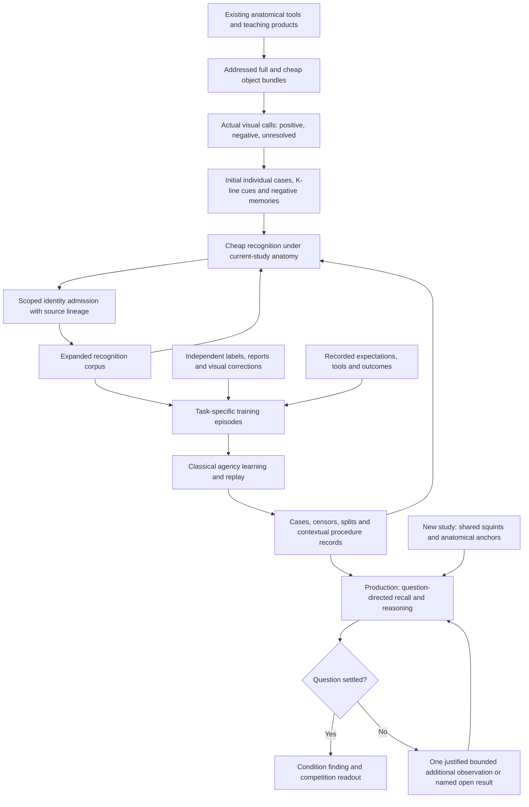

# Bootstrap, training and the living K-line memory

**Output authority, Rohan's explicit correction2026-10-22:** a warranted categorical diagnosis emits exactly1, a warranted categorical absence exactly0; only unresolved cases receive graded numerical values. Learned navigation/probabilities never overwrite decisive symbolic findings. Preserve raw model opinion separately. No fitted probability cutoff creates warrant. The first universal-float adapter and its first release bundle were withdrawn for this error.

**Author's controlling clarification, 2026-10-22:** «Use the paper’s three-stage learned navigation
layer over HDC signals». [Literal question and answer](conversations/2026-10-22-three-stage-navigation-training.md).
Small parameterized specialists and an orchestrator train over fixed precomputed numerical/HDC
signals: specialists, then a frozen-specialist orchestrator, then joint refinement. Prior agent
prohibitions on every fitted weight or treating memory append as the whole training mechanism
are superseded for this explicitly selected layer. This does not change anatomical definitions,
measurement meanings, signed cases, label scope or the exact HDC carrier. Learned opinions must
be distinguished from independent teaching and from warranted categorical findings.

Execution-design appendix to [FULL_BUILD_PLAN §§17–18](FULL_BUILD_PLAN.md#17-approved-squint-first-production-build--2026-10-21), written at Rohan's request on 2026-10-21 for the next implementing agent. It explains the complete data flow and the meaning of its parts. It is not another live work queue. [The active packet](work/current/README.md) alone records source pins, completed checks, jobs and the next operation.

**Authority:** Rohan's literal conversations, then the project theory and the *What an \<Object> Is* thesis. This document is Codex's engineering binding of those sources, not additional words attributed to Rohan. Existing source-specific contracts remain applicable. Proposed interfaces below describe required meanings, not claims that a corresponding implementation already exists. The admission, signed-scope and worked-example corrections in §§5–7 and §14 bind the next integration. Where the custom design genuinely leaves an operation unspecified, follow §15 rather than supply an unrelated learning method.

**Latest author clarification and execution binding (2026-10-22):** read
[CLASSICAL_AI_TRAINING_EXECUTION.md](CLASSICAL_AI_TRAINING_EXECUTION.md) before implementing learning
or launching scale rounds. There is one society: support/pixel assignment, anatomical role,
physiological state and diagnosis are connected activities over the same object representation.
Anatomy and physiology have related but different roles; a cheap scan-calibrated middle is not
a definition of healthy function. The endpoint remains the twelve Kaggle diagnostic questions,
with warranted assignments and retained uncertainty. Local preparation serves that endpoint.
The appendix incorporates his literal mid-turn corrections and the bounded consumer repairs;
the active packet alone records their implementation state.

## Implementation checkpoint — 2026-10-22

This is a dated evidence checkpoint, not a second live queue. The packet named by
FULL_BUILD_PLAN §13 owns the next action and any later accepted artifacts.

- **Accepted case memory:** `reviewed-category-learning-r3`, manifest SHA256
  `ccd01612d36eae5a25a73c03a6937fc44ad9317e8390a71d13beac5c55d23da8`.
  Its saved directory is
  `data/readings/grounded-teaching-20261022/growth-batch-20/next-wave-run-r1/category-review-r3/published-learning-child-r1/memory`.
  This signed memory and its provenance remain distinct from learned navigation weights.
- **Training is implemented and has run:**
  [dataset-r2 receipt](../data/readings/som-navigation-20261022/dataset-r2/receipt.json)
  records 118 saved-study rows: 106 training and 12 validation, with 63,502 numerical/HDC
  features. The training rows include the 58 official teaching studies and 48 fresh studies.
  [train-r2 receipt](../data/readings/som-navigation-20261022/train-r2/training-receipt.json)
  records 1,074 known training targets, 82 known validation targets and 10,566,320 parameters.
  The three stages completed 20/20/10 epochs: specialists first, then the gate with specialists
  frozen, then joint refinement at one tenth of the earlier maximum learning rate. Each stopped
  at its epoch cap; this is not a claim of convergence. The saved NumPy artifact is
  [train-r2/navigation.json](../data/readings/som-navigation-20261022/train-r2/navigation.json),
  SHA256 `ea487781d8b0653b3045f17ec7218137d0e9da699bc56e0a89e93e257353b39b`.
- **The representation stays fixed.** `som_features` reads retained measured profiles and
  signed recall evidence; `som_training` trains the expressly authorized navigation layer;
  `som_navigation` evaluates its saved weights with NumPy. Learned per-question trust can
  order existing discretionary observation requests and grade an open condition. It does not
  redefine anatomy, change exact HDC rows, invent a procedure or turn a study label into a
  localized lesion. Warranted symbolic assignments still emit 1, warranted defeats 0; open
  findings use their retained grade under `knee.warranted-endpoints-open-grade/v1`.
- **The latest consumer repairs are implemented.** A changed object's observation refreshes
  the condition questions that consume it, rather than leaving another question's earlier
  finding stale. Configuration defining-tissue coverage requires actual `role=object` banks;
  surroundings can contribute comparison evidence without certifying tissue. A study-positive,
  unlocalized fracture/contusion comparison on only one bone receives the typed
  `unlocalized_single_bone_presentation` coverage result: configuration wrapping adds no authority.
  Localized positives, actual joint configurations and warranted whole-normal configurations
  retain their existing authority. See the source-pinned
  [consumer replay](../data/readings/som-navigation-20261022/reasoning-repair-r1/repaired-consumer-checks.json).
- **Three different checks must remain separate.** The
  [58-study teacher replay](../data/readings/som-navigation-20261022/teacher-readback-r2/SUMMARY.md)
  evaluates trained navigation on saved teaching profiles; its categorical findings are the
  saved symbolic findings, not new image reasoning. The
  [12-study validation replay](../data/readings/som-navigation-20261022/validation-r2/SUMMARY.md)
  is separate from gradient training but was used for epoch retention/PAB, so it is not an
  untouched final test. The repaired raw-image 58-study check was
  [interrupted at the user's request](../data/readings/som-navigation-20261022/gold58-current-check-r2/root-interruption-receipt.json):
  four complete 12-question records remain, exit code 130, with no complete cohort receipt.
  It establishes no full-58 result. Earlier saved replays do not certify the repaired pipeline's
  full-cohort behavior.

## 1. The complete objective

**Development objective when work is authorized: local bootstrap, corpus teaching and agency training.** Rohan has paused execution; FULL_BUILD_PLAN §13’s packet owns that state. Read §18.1 before choosing any later operation. The immediate loop is visual teaching -> contextual
recognition -> warranted corpus growth -> reviewed child memory -> recall with that child.
The corpus supports the designed Minsky/Winston agency training; the dated checkpoint above
records the implemented trained navigation layer. It is not necessary to
package or run this bootstrap apparatus on Kaggle. Three computers are available for the math;
the SSD corpus is being extracted. Deployment is a later use of the trained system, not the
completion criterion for the current phase. The full objective below remains the eventual goal.

Build one classical-AI operation that takes a knee study, uses cheap observations and remembered experience to recognize diagnostically relevant anatomy and its states, reasons about the twelve competition conditions, and returns the required values with traceable evidence. It should usually settle its questions without reconstructing precise anatomical borders. Existing detailed measurements remain available as tools for a bounded question that cannot otherwise be settled.

The complete sequence is:

1. Use the existing deterministic anatomical tooling and teaching products to obtain real, recognizable examples.
2. Make positive and negative visual calls and store their bundles as initial recognition memories.
3. Use those memories, HDC comparisons and anatomical reasoning to find and admit further examples at scale under Rohan's stated admission policy.
4. Build task-specific training material from those observations, calls, independent clinical evidence and the system's recorded expectations and outcomes.
5. Teach and improve the agencies through scoped case/procedure learning and the author-approved three-stage specialist/orchestrator training over fixed HDC signals: what interpretations hold in which contexts, what failures to prevent, and which existing procedure a situation calls for.
6. Keep the K-lines, censors and other learned records active during recognition, reasoning and orchestration in production.

**K-lines have both roles:** they enable the initial recognition needed to assemble the larger corpus, and they remain part of the classical AI's working memory. They are not disposable dataset scaffolding. Equally, writing more bundles into buckets does not by itself implement the complete learning and reasoning process.

Rohan's latest clarification governs the terminology:

> Well, K-lines are how we recognize, how we bootstrap the classical AI system, it's part of the AI process, but...it's not LITERALLY training?

Earlier references to filling buckets as the equivalent of training identify its enabling role. Do not turn that analogy into a claim that corpus construction exhausts learning. The signed memories retain structured expectations, differences, exceptions and procedures in context. The separately trained specialist/orchestrator layer learns navigation over the fixed representation, as Rohan explicitly authorized; its fitting does not replace those memories or the measurements.

## 2. Terms and the two roles of K-lines

| Term | Meaning and consumer |
|---|---|
| Measurement | A named observation with source, scope and availability. It reports its quantity; it does not decide an anatomical or diagnostic question. |
| Object profile / bundle | The encoded observations of one object or addressed region, including relevant view, scale, direction and context distinctions. Recognition and reasoning read it. |
| Call | A sourced assertion about a named question at an explicit scope: for, against, or nothing asserted. It is distinct from the structure's proposed answer. |
| Case | One individual bundle with its call, context, proposed expectation, correction if any, and source. Keep each case individually recallable. |
| Bucket | Cases relevant to an answer, question and context. It is not a class-average hypervector. |
| K-line | Memory recalled by a cue that reinstates an interpretation and the relevant way of proceeding. In this implementation a case's bundle supplies that cue. The thesis also describes the cases of an answer collectively as its K-line; operationally, comparisons preserve individual cases. |
| Ordinary negative memory | A confirmed case with a −1 call on a particular interpretation. It is available as negative expertise immediately; it does not require first discovering a special near-miss rule. |
| Near-miss censor / split | A further refinement based on a confirmed failure and a significant named difference. Its applicability and scope are narrower than a global ban on an object or procedure. |
| Agency | A bounded classical learner/reasoner with its own question, available procedures, oracle or teaching evidence, memory and outcome. It works through the common representation. |
| Training experience / episode | A problem in context, the expectation and action it produced, and the appropriately sourced outcome. Its consumer is the agency learning that task. This names retained information, not a required universal episode schema or framework. |

Minsky's operational point is important: a K-line remembers useful activity, not merely an answer token. For this project, a recalled case must retain the link from observations to interpretation and from that interpretation to the procedure it warrants. A scalar similarity printed beside a class name is not the complete mechanism.

Winston's contribution is equally concrete: compare structural descriptions, identify the significant difference in a confirmed failure, and refine the expectation or its exceptions. The exact HDC decode supplies named differences; it must not be reduced to an unexplained distance score.

## 3. End-to-end flow

The growth and teaching arrows operate in explicit development/training rounds. Competition inference consumes a frozen memory and does not rewrite its own authority while predicting the hidden studies. The same case representation participates in both training and runtime; these boxes do not require duplicate incompatible storage systems, a universal episode framework, or strictly separate calendar phases. Implement the current signed recognition-to-admission-to-next-memory operation first, retaining the information that actual task-specific learning needs.

## 4. The representation that all stages share

Follow [HDC_ENCODING.md](HDC_ENCODING.md) and the author conversations. Do not replace the exact substrate with a textbook random-vector approximation.

- One anatomical object has one representation across its available lenses and views, with named direction and scale facets. Per-view readings are contributions to that identity, not unrelated objects.
- Its sagittal, coronal and axial key planes jointly constrain its physical reference where available. Never substitute the centroid of one largest cross-section. Partial geometry stays partial; recognition does not require all three outlines.
- Measurements occupy orthogonal banks/rows. Numeric below/middle/above readings, authored words, missing observations and semantic calls retain their different meanings.
- A measured neutral row is an observation. An unread bank writes no row. Neither silence nor a raw scan-calibration middle implies healthy anatomy.
- Bundle places through the existing exact count representation. The common Hadamard factor cancels in compatible cosine comparisons; use the existing integer/rational decision operations. Exact decode names differences in their original banks and meanings.
- Keep individual examples. Summing all normal cases into one normal prototype would lose which readings co-occurred within each example.
- Full and cheap descriptions coexist under one case, with compatible shared readings and genuinely unwritten banks kept distinct. A cheap query does not manufacture full-only information. A new fine reading adds its own addressed information.
- Preserve sources and actual pixel/value addresses. A case can be useful with a rough or partial support. That does not permit naming unrelated tissue, silently copying another patient's coordinates, or calling a box an observed border.

Anatomical definitions are information about the domain. Measured satisfaction of a relation is evidence about this knee. A proposed object's name or its selected catalogue definition must not appear as independent observational proof of that same name.

The healthy object's meaningful reference is grounded in anatomy and clinical definitions. The polarity calibration of a raw MRI reading is a separate measurement contract. Do not replace either with fitted cohort percentiles or invent universal raw-intensity healthy limits.

## 5. Calls must retain positive, negative and silent meanings

The unit of a call is **a named question about an addressed object/region/view**, not a global good/bad flag. One example can speak differently on different questions.

| Actual warranted observation | Identity question: femur? | Diagnostic question: fracture? | What may be stored |
|---|---:|---:|---|
| The pictured support is clearly femur | +1 | 0 unless separately established | Positive identity case |
| The pictured support is clearly posterior soft tissue, not femur | −1 | 0 | Negative femur case, with the wrong proposal retained |
| Tissue identity cannot be settled from the available view | 0 | 0 | Unresolved finding; no manufactured negative |
| An independent source establishes fracture, without locating a bone | 0 from that statement alone | +1 at study scope | Condition-presentation case at that scope |
| An independent source establishes no fracture at one named bone | 0 from that statement alone | −1 at that site | Local negative; not an all-bones negative |

If the actual alternative identity is also known, record its positive call at the warranted scope. Knowing “not femur” alone does not supply a positive identity for another tissue. Apply further exclusions only through a stated domain relation, not a blanket one-versus-everything conversion.

If one candidate has a valid coronal facet and a wrongly named axial facet, retain the correct positive and the confirmed negative at their respective scopes. A single whole-case `confirm/reject/unsure` enum cannot express every such combination. Extend the existing admission contract so these facts can be represented without overwriting the original proposal or duplicating observation votes.

Adapt existing review records losslessly: when a rejected proposal records its asserted negative scope in `negative_views`, that exact scope becomes the reject call's own `views` in the current builder format. Do not drop the field and let the reject expand to every drawn view. On a confirm, preserve its positive views separately from its negative views and any independently asserted alternative identity. A missing or unasserted facet stays unasserted. This is a format adaptation of the original reviewer's call, not a new visual decision.

The views jointly describe one candidate. A joint match does not certify every contributing view independently; exact positive/negative teaching scopes remain available during comparison and publication. Do not require three independent per-view identity classifiers before recognizing the object.

Keep three operations separate:

1. **Ordinary negative teaching:** a visually confirmed −1 is a real case and participates on that question's negative side.
2. **Near-miss learning:** a confirmed wrong expectation is compared with the precedent it recalled and that K-line's successful cases. A significant named difference that distinguishes the failures under the thesis's §8.6 test may yield an answer-specific censor; variation among successes may instead justify a split K-line. Where neither is established, keep the failures without an additional refinement. Retain the ordinary corrected negative immediately. Judge the significant anatomical/semantic difference, rather than counting changed banks: multiple readings can describe one fact, and two failures sharing one brightness reading do not by themselves establish a censor. Do not invent a bank-count cutoff, a fixed required number of failures, or a new numerical chance rule.
3. **Law-given exclusion:** an applicable anatomical law can forbid an interpretation independently of resemblance. A weak box or uncertain neighbour is not such a law violation.

In the cell drawing example positive/negative cases act as attractors/repulsors. Knee categorization does not need that boundary-drawing stage. Its relevant mechanism is signed recognition and reasoning, with the thesis's scoped near-miss veto semantics. Do not turn every ordinary negative into an unconditional veto everywhere.

### 5.1 A diagnosis belongs to its object, in every view where the object is present

Rohan: «if a diagnosis is clear in one of the three views (coronal/saggittal/axial), then IF the object
is also present in another view, that is an IMMEDIATE positive k-line». One leg, one set of objects
(THEORY Law 9): a diagnosis clear in one view of an object is a diagnosis of that object. Every other
view in which the same object is present, its identity established there, is at once a positive case of
that diagnosis at that view's scope, sourced to the view where it was clear. That view need not show the
diagnosis clearly itself; teaching the subtle view is exactly what it adds. The condition is the object's
presence: a view whose support is other tissue (a negative identity facet) carries nothing, and an
unasserted facet carries nothing until the object's identity is established there. The carry is
positive only: a view in which the object looks normal does not make the object normal.

In teaching this means a positive label, report call or visual call for a condition implicating one
object makes every view in which that object is recognized a positive presentation. For a multi-site
condition such as fracture or contusion, a study label does not say which bone; the view in which the
diagnosis is clear names the object, and that object's other views follow. Identity scope therefore
decides diagnosis scope: a case's condition evidence speaks only through the views where its identity
holds, for positive and normal presentations alike.

## 6. Bootstrap: establish the initial recognition corpus

**The labelled studies supply the normal objects too.** Rohan's explicit rule: the 58 studies give
the diagnosed conditions, so correctly identified objects not implicated by a study's positive
conditions are valid normal examples. Use the existing condition/object relationships and keep
the official row as provenance. Do not require a new normality annotation for each such object.
Missing labels are not negative labels; implicated multi-site conditions keep their actual scope.

**Hand-building is the current operation.** Rohan's 2026-10-22 correction explicitly rejects
perfect or complete automatic recognition as a pre-AI prerequisite. Use recognition to help
isolate useful objects, and select them directly on the image when needed. Establish their
anatomical and normal/diseased meanings, retain their bundles as K-lines, and use that corpus to
bootstrap the AI. An automatic refusal does not withhold an independently warranted visual call.

Use the existing teaching studies and their already retained products. Their automatic object names are proposals, not visual calls. Make teaching sheets from actual native images and the actual addressed readings. Do not rerun every anatomical measurement just to recreate the evidence.

For every candidate that can be called:

1. Look at its actual images in anatomical context.
2. Record every warranted positive and negative call, with the actual reviewer and views/regions it concerns. Retain unresolved facets separately.
3. Link the call to the original bundle and available full/cheap descriptions, source study, acquisition, support and writer identity.
4. Preserve the structure's proposal and how the actual call corrected it. An incorrect proposal is useful teaching material.
5. Publish a fresh immutable memory and verify that the ordinary reader and recall consumer can use its signed cases.

**Admit all correct recognizable examples.** “Start thin” permits beginning before coverage is complete; it does not set a quota or instruct agents to leave easy correct examples uncalled. Rough boundaries are acceptable. Missing views do not invalidate available correct facets. No repeated per-case human approval is required: Rohan authorized the lead's common-sense visual calls, with truthful authorship. Genuine ambiguity can go to him with the exact picture and unresolved question.

The initial corpus enables recognition. Do not make its untrained discrimination a pass/fail gate that prevents supplying the cases it needs. Early findings can identify useful teaching questions, but they do not choose a new objective or justify abandoning the representation.

## 7. Recognition expands the corpus and makes training data obtainable

Rohan explicitly authorized high-confidence identity recognition against the teaching cases, together with common-sense anatomical checks, to add candidates to their object buckets. Implement that operation; do not impose a new requirement that he personally label every new object.

A round consumes a frozen memory and new candidate observations:

1. Read each study cheaply and share its leg/background, squint and anchor information.
2. Resolve useful bone anchors structurally, then propose dependent regions through current-study anatomical relations. Use resemblance among meaningful candidates. Avoid a whole-leg sliding-window search followed by anatomical rejection.
3. Write new candidate profiles through the same compatible writer, using only information actually observed.
4. Recall individual positive and negative cases over the named question's banks, with censors and anatomical checks.
5. Admit warranted identities under the policy in §7.1; retain conflicts and missing evidence with named outcomes. A proposed name cannot silently override a contradictory recalled identity.
6. Preserve parent revision, seed/case lineage, source addresses, exact call scope and the fact that an admission was recognition-derived. Publish the next immutable memory only after its records are complete and readable.

Every correct example contributes useful variation. A negative identity example can also enter when its negative fact is established. A failed match, expired deadline or anatomy check with insufficient evidence does not establish a negative. Independently warranted visual calls can teach directly at their actual scope; the automated new-admission requirement below does not discard those calls because their geometry is partial.

**The independence distinction must not block the authorized loop.** Recognition-derived identity cases may grow the corpus and be available in subsequent rounds. Their provenance does not become an independent visual or radiological call. Repeating a prediction through descendants is not new independent confirmation of its ancestor, does not establish diagnostic truth, and cannot manufacture the oracle-confirmed error required for learning a new censor. Preserve that source distinction rather than either banning corpus growth or laundering it into ground truth.

No new case teaches within the round that generated it. Query sources must not match their own stored cases when measuring held-out recognition. Evaluation exclusions remove the whole study from candidates, location precedents, censors and comparison preparation. These are engineering guards for lineage and meaningful checks, not an extra accuracy target.

### 7.1 Answering and admitting are different decisions

For an inference question, an unavailable anatomical check is neutral: it establishes neither the object nor a contradiction. **Neutrality alone is insufficient to publish a new recognition-derived teaching case.** Automatic admission requires high-confidence joint identity recall under the existing exact concurrence mechanism, affirmative applicable anatomical plausibility evidence, and no known applicable contradiction or unresolved signed identity conflict. Preserve the evidence that supplies each part of that warrant. No new cosine cutoff or global classifier is introduced by this requirement.

The current recall API's `admitted` field is historical recognition eligibility, not a publication
receipt. The growth consumer must establish the support, signed scope and lineage required here
before writing a new case. Do not use that field alone as permission to publish.

| Available evidence | Inference meaning | Automated new-memory outcome |
|---|---|---|
| Applicable current-study anatomy supports the recognized identity, with no known contradiction or identity conflict | Supported interpretation, at the actual available scope | Eligible for the existing admission checks and immutable publication |
| Every applicable anatomical check is unavailable | No anatomical conclusion | Keep a proposal; do not admit and do not teach a negative |
| A known applicable anatomical finding contradicts that identity | Contradicted interpretation | Refuse that admission with its reason; it is not an independent clinical negative |
| Signed recall conflicts or cannot establish the identity | Identity unresolved | Keep the conflict/proposal; do not manufacture a case |

Affirmative support does not require every rule to run, all three bone planes, exact boundaries, or recognition of the whole knee. Use whichever directions the available native planes actually constrain; leave other directions unknown. A useful applicable relationship may provide the support. A proposed name, another patient's coordinates, or the mere absence of a contradiction cannot supply it. Development review may inspect a round's admissions and correct errors; it is not a permanent requirement for a human to approve every case at scale.

Name the actual observed anatomical fact supplying support. It can be applicable intrinsic structure
or a relation to established current-study context; do not create a circular requirement that every
anchor already have a recognized neighbour. The HDC match or a bare `plausible` status is not, by
itself, an additional anatomical observation. Preserve the supporting measurement and its scope.

**What an anatomical pass establishes.** The sanity check is a law check (thesis §§1.14, 11.5): a
candidate that breaks an applicable relation is ruled out, and a pass settles nothing alone, because a
wrong answer that breaks no law passes it. A pass on "femur above the tibia" establishes that the
candidate lies where a femur can lie. It does not establish bone tissue, and the admission record keeps
exactly that meaning: the rule, axis and intervals that passed. Telling the femur from plausible tissue
beside it is the joint work of recall over positive and negative cases, never of one check alone
(«It's not SUPPOSED to be isolateed by ANYTHING alone»). A confirmed negative such as posterior thigh
tissue, or #8's peripheral soft tissue beside the condyle, speaks against a resembling candidate wherever
it lies; that is what the negative K-lines are for. Do not make a standalone anatomy classifier for each
object a prerequisite of growth. The map's distances aim the search: its sites are expectations and its
spans search allowances (`knee.collapse.anatomy_map` module note), never admission limits («A map is a
guide»). A hard anatomical limit needs a warranted anatomical meaning, drafted from the pictures through
FULL_BUILD_PLAN §7's rule review, and is added only when a recurring failure shows the structure is
missing (§13 step 5).

### 7.2 Anatomical constraints concern established tissue

Apply relations against evidence about this study's anatomy. Partial bone planes may constrain an axis without defining a complete 3D point or volume. Use that available constraint in candidate generation and in plausibility checks, retaining which parts are observed and which remain priors. Do not wait for a complete three-plane reference when the relevant relation is already decidable.

Most acquisition planes are oblique (over the 61 local studies the median tilt from the nearest body
axis is 7°, the largest 38°; only 3 of 351 series lie exactly on an axis), so a partial reference's own
plane rarely determines a body axis. Where neither a complete reference with its precision nor an
exact-normal partial interval determines the axis, the anchor's interval on that axis is the exact
projection of its own observed tile window onto the axis, computed by the same function that projects
candidate windows (its window in the candidate's own series first, otherwise the union over its series,
which can only add neutral overlap). That is observed geometry on both sides of the comparison, with no
tolerance or map distance; each check records which construction it rested on. Because this lets more
bone pairs be checked, its effect on anchor quarantine and placement is measured over the local studies
before it is accepted.

A window is not a measured tissue volume. Two alternative names for one candidate are rival interpretations, not two independently established objects occupying the same space. Consequently, overlapping windows or competing femur/tibia recall cannot trigger a blanket occupancy veto. An exclusion must follow from an applicable relation to established anatomy at the available precision; the source and anatomical meaning of that relation must remain inspectable.

## 8. What the training material must contain

The expanded corpus is usable input to classical learning, not merely more pictures or a CSV of predicted names. Reuse existing case/observation/report schemas and extend them deliberately where necessary. The following are logical information requirements, not a second storage format:

| Information | Producer | Consumer and purpose |
|---|---|---|
| Object/region observations and full/cheap profile links | Existing products and the shared current-study writer | Recognition; source-backed named differences; later replay without remeasurement |
| Signed calls with question and scope | Visual review, independent labels/reports, or authorized identity admission with distinct lineage | The appropriate case bucket and the relevant agency's teaching input |
| Expected interpretation and recalled precedents | The actual recognition/reasoning run | Establish what the system expected before a correction |
| Anatomical findings and relation provenance | The actual domain checks and named inference chain | Determine context, applicability and why an interpretation was possible or contradicted |
| Procedure selected and its inputs/outputs | The actual orchestration path | Learn and replay what information or action a situation called for |
| Outcome and its authority | The agency's appropriate independent check or explicitly labelled recognition-derived source | Distinguish a confirmed success/failure from the system merely repeating its own answer |
| Exact decoded difference where available | Existing count/layout decode on compatible observations | Winston-style correction, censor/split construction and explanation |
| Parent/child/source/writer identities | Publication and admission | Reproducible rounds, exclusion, deduplication and non-circular evaluation |

Identity, normality and a specific diagnosis are distinct questions. The official labels and radiology reports can supply clinical calls at the scope they actually assert. A positive study-level fracture label does not label every bone fractured. A correctly identified object is not automatically healthy, and an object the locator failed to find is not clinically absent.

Read reports into sourced present/absent/unknown statements, preserving negation, uncertainty, localization and the actual sentence. A report's silence is not a negative. Independently supplied clinical calls can be joined to recognized objects/configurations at compatible scope; they are not fed into image features or query construction. Report reading can run in parallel with visual identity teaching and mechanical build work.

Do not require a completely filled corpus before beginning useful task-specific learning. The curriculum can grow with the corpus. Retaining an expectation, action and correction need not introduce a new universal episode format. Likewise, a green software gate is not evidence that every learning example or clinical interpretation is correct.

## 9. Classical agency learning and the continuing memory

The thesis's cell instance has counting, cell identity, position and division agencies. Do not copy that roster or its temporal assumptions into knee diagnosis. Here the existing pipeline has the following responsibilities. This table states their questions and evidence boundaries, not a requirement to create exactly four classes or a new framework:

| Responsibility | Question / tools | Appropriate teaching evidence | Role of memory |
|---|---|---|---|
| Candidate discovery and anatomical placement | Where is useful evidence likely to be in this knee? Shared squints, bone anchors and authored relations | Visually checked teaching observations and actually resolved geometry, at its available precision | Recall useful contexts and routes; avoid impossible or already explained work |
| Object identity | What anatomical object does this observed profile support? | Visual identity calls; authorized recognized additions retain their separate lineage | Positive identity cues, explicit negatives, scoped near-miss censors and conflicts |
| Object state and condition reasoning | Normal for this question, a diagnosed presentation, or unresolved? Which relations matter? | Official labels, source-backed report calls and appropriately scoped visual/clinical interpretation | Normal/presentation precedents, role-qualified configurations, exceptions and named differences |
| Residual orchestration | What additional available observation could settle this open question? | Actual paired observations and recorded procedure outcomes checked against the task's appropriate oracle | Reactivate the relevant procedure and its preconditions; remember contexts where it fails or is unnecessary |

For case-memory teaching in an existing responsibility:

1. State its question, context and actual available information.
2. Record what the current structure/memory expected and which existing procedure it selected.
3. Compare the result with evidence appropriate to that question. Law checks support; an oracle establishes only what it can actually observe.
4. Keep confirmed cases, correct interpretations and departures with their sources. Where a failure has a significant named difference, invoke the existing near-miss/censor/split mechanisms at their warranted scope.
5. Where no meaningful difference or confirmed outcome is available, keep the question open. Do not invent an exception or a negative from a refusal.
6. Replay with the next memory snapshot and inspect identified/abstained/wrong per question/context, together with the actual tools and compute used. Use the trajectory to discuss remaining structure; do not optimize one combined score.

These steps describe case/procedure teaching; they do not prohibit or exhaust the implemented parameter training. `prepare_som_navigation.py` exports retained measured profiles and signed recall evidence with independently sourced, masked study-condition targets. `train_som_navigation.py` trains specialists, then their per-question orchestrator with specialists frozen, then refines both at the lower learning rate. The frozen HDC vocabulary, measurement meanings and signed memories remain inputs. Each specialist gives a study-condition opinion from its applicable domain and context, not a localized lesion annotation. Study-group splits, train-only conditioning and missing-target masks remain explicit in the saved schema and receipt.

Both mechanisms improve recognition, discrimination and orchestration. K-lines stay active: they recall interpretations, recruit procedures and make applicable exceptions available. The saved navigation weights additionally provide per-question trust and graded opinions. Neither parameter training nor case publication turns the pipeline into a memoryless consumer of a static table.

The structure continues doing the work it already knows. Agencies learn what the current context leaves unresolved; they do not relearn anatomy from scratch or turn each lens into a feature tuned for one diagnosis. Shared-source observations remain one information source, not multiple independent votes.

### 9.1 One example through both uses

Illustration of the contract, not an additional anatomical rule or a claim about a completed run:

1. A structural proposal names a selected soft-tissue region “femur”. Visual review establishes that the selected tissue is not femur. The exact alternative muscle need not be known.
2. Its existing bundle, source and scoped −1 on the femur question enter memory. It is a real negative recognition precedent, not a dropped candidate or a clinical negative.
3. On another study, resemblance to that case can oppose interpreting a similar region as femur. Anatomical relations and the other cases remain available. Recognition can now avoid repeating this kind of mistake while building the larger corpus.
4. The original expectation, visual correction, context and named profile difference also form material for the appropriate agency's learning episode. Where the near-miss criteria hold, learning can refine that expectation or its procedural applicability; otherwise the confirmed negative remains useful without an invented generalized rule.
5. In a subsequent production question, the case and any warranted refinement are still active. Recall recruits the appropriate interpretation/procedure or prevents the failed one. They were not consumed and discarded when the training material was assembled.

The same retained experience therefore enables corpus construction, supplies learning material, and participates in the later classical reasoning. Those are connected uses with different responsibilities, not three unrelated stores and not one operation renamed three times.

## 10. Production with that memory

The required route remains the single existing entry point: `scripts/run_interiors.py` -> squint CLI/coordinator -> per-study observation, location, recall, condition reasoning and output. Reuse existing modules; adding a tested helper without its real consumer does not complete a stage.

For a new study:

1. Load the frozen compatible case memories, invariant preparation and selected learned-navigation artifact once at the appropriate process/operation scope. Verify the model's schema, feature-writer identity and artifact pins; preserve a named unavailable result if it cannot apply.
2. Read series with bounded I/O concurrency. Establish a useful leg/background prior and cheap multi-view observations once.
3. Use current-study anchors and anatomy to target the evidence. Cross-patient precedents guide resemblance and relative expectations; they do not transfer patient pixel locations.
4. Ask the relevant identity/state/configuration questions through their predeclared compatible banks. Hear positive and negative cases and apply applicable censors.
5. Make recognized identity govern what condition reasoning may read: a region established as the wrong identity must not remain evidence of the originally proposed tissue. An unresolved identity does not establish disease absence. Preserve the raw observations and reasons, and route any justified next question through the existing bounded tool. Propagate anatomical relationships and clinical condition contracts; an already settled question does not schedule another measurement.
6. Where evidence is sufficient and uncontradicted, decide. Where it conflicts, preserve the conflict. Where unavailable, preserve the named open result.
7. Only a still-open question with a justified available procedure requests a bounded additional reading. Learned trust may order existing discretionary requests without dropping mandatory work or inventing a procedure. Reuse what is already held, encode the new observation in its own actual banks and refresh every condition question that consumes the changed object.
8. Write the twelve official outputs through the existing readout adapter: warranted assigned is 1, warranted defeated is 0, and an open finding receives its retained numerical grade. Preserve the symbolic finding, raw navigation opinion and serialized value separately. Finish and release the study's working data.

Production need not identify every anatomical object, draw every border or run every tool to answer a condition question. Bootstrap's broad recognition capacity supplies the tools and precedents that make selective operation possible. Cheap recognition and useful priors are allowed to settle questions; the system does not earn authority by spending more compute.

This handoff changes no probability/readout formula. Preserve the currently approved adapter and its separate categorical evidence; do not choose a fresh mapping from cosine to probability while implementing memory or training.

## 11. Concurrence, censors and diagnostic scope

- The question chooses the applicable banks before resemblance is computed. Compare like measurement meanings, with missing information explicitly silent. Exact pixel alignment or cosine equal to one is not the recognition requirement.
- Ordinary positive and negative cases speak at their stated scope. A near-miss censor can veto its one answer within its justified applicability. Known anatomical contradictions and remembered resemblance are different evidence types.
- Recall assigns an interpretation by the existing concurrence contract. Do not settle opposing warranted answers by nearest-case priority, majority vote or an average. Coexisting diagnoses are not automatically competing answers.
- Hear normal and diagnosed precedents on the tissue actually observed. Partial normal evidence may reduce support for an overlapping claim without proving every possible site normal. A sufficient localized positive is not cancelled by an unrelated normal site.
- Rohan's instruction “Let warranted configuration recall decide” remains in force. A whole-condition case may decide when its actual comparison includes the defining tissue and no necessary anatomical finding contradicts it. Supporting context cannot impersonate unread defining tissue.
- Apply the condition's own necessary, sufficient, alternative and supporting relations to local findings. One normal site does not establish that every site is normal. **Later author decision, 2026-10-22:** «Let warranted whole-normal configuration recall decide». An independently diagnosed whole-normal precedent can therefore decide absence when its actual comparison includes condition-defining tissue and has no applicable contradictory finding; it does not need separate negative calls at every site. This recalls an already taught whole-condition meaning, rather than inferring whole-condition absence from one local negative. Context-only, unwarranted or conflicting comparisons cannot decide. Opposing warranted whole-condition configurations stay open, including when they compare different defining sites.
- Clinical calls stay clinical; identity calls stay identity calls. A source-labelled presentation can be valuable even when it is not a localized lesion annotation.

`SIGNIFICANCE_WEIGHTING.md` explains why resolving a fact can constrain a cluster of connected questions and why confirmed exclusions can sharply reduce the remaining search. Shared evidence must retain its dependence; do not invent hand-set per-condition weights from that paper. The explicitly authorized navigation model learns its own per-question trust under the recorded training contract. `law_as_architecture.md` supplies the principle of composing specialists according to the domain and recalling contextually appropriate experience; its drilling coefficients are not knee parameters. Learned blending of numerical specialist opinions does not average away contradictory warranted categorical findings.

## 12. Efficiency, retained information and deployment

Efficiency is part of the design, not a later optional pass. Known relationships eliminate unnecessary questions; memory eliminates repeated rediscovery; negative expertise can prevent an inappropriate search before it starts.

- Compute a shared observation once and hand it to every consumer. Cache by actual source, writer, context and memory revision, not a filename alone.
- Keep invariant case projections/preparation across queries and studies where valid. A study-excluded view has its own exact identity. Do not repeat corpus-wide pairwise preparation per object or per study.
- Use compact exact counts and shared read-only context, not dense hypervectors per pixel or complete expanded profiles in every worker.
- Read cheap banks first and retain richer payloads lazily. Train/replay on retained bundles and results where possible instead of rereading images or rerunning recognition.
- Target native work by anatomy, the key view and the unresolved question. Do not optimize an avoidable exhaustive scan into a faster exhaustive scan.
- Parallelize independent construction and independent studies with measured bounds on pending work and native thread pools. Release each completed study. Do not hold the cohort's decoded volumes in RAM.
- Retain complete required object outputs, measured values and provenance; release consumed intermediates after their consumers and verified publication finish. The current retention contract does not require keeping every transient lens array in competition mode.
- Follow FULL_BUILD_PLAN §16.9 for W8b storage closure and W10 whole-operation capacity: nine-hour offline notebook limit, actual selected CPU/RAM/output/scratch resources, startup/decoding/recall/refinement/output costs and room for later work. Label measurements and projections separately. Recheck the runtime at deployment.

Use existing profiling, ledger, Vulture and CodSpeed leads to find repeated or unused computation. Use compiled kernels only on measured useful residual work, preserving the exact reference semantics. Memory growth does not authorize replacing individual cases with a lossy class prototype.

## 13. Concrete build order and parallel ownership

This is the dependency order for maintaining and extending the working loop, not a declaration that every stage remains unbuilt or a requirement to finish every lane before starting another. The checkpoint records completed implementation; FULL_BUILD_PLAN §13's packet owns current work.

1. **Publish all warranted signed teaching.** Adapt the current calls without widening their views. Integrate the existing signed builder, retain positive, negative and alternative-identity bundles, and verify ordinary readback and recall. Useful negative-only teaching is valid. Continue the remaining visual calls and independent report reading alongside this work.
2. **Repair frozen-parent growth.** Preserve every signed case table and paired full/cheap payload in the child. Derive study exclusions from every relevant record, including negative-only studies, and apply them to cases, precedents, censors and preparation. Apply §7.1: unknown-only anatomy leaves a proposal. A recognition result and successful immutable publication are separate outcomes.
3. **Expose available anatomical support.** Let sanity checks consume partial bone-plane constraints by their actual axes. Use affirmative applicable relations and named contradictions, without demanding a complete point or applying a window-overlap veto.
4. **Connect identity to the real condition consumer.** Verify which observations may answer each tissue question after recognition, preserve unknown/conflict, and let a recalled procedure cause only its justified bounded work. A serialized identity result or procedure name that nothing consumes is unfinished.
5. **Preserve the demonstrated growth-round contract.** Run the real entry point through candidate production, signed recall, identity-dependent condition reasoning, warranted admission, child publication and the next round reading that child. Both rounds must preserve the same signed mechanism and applicable exclusions. Before the first round's child becomes the next round's parent, inspect all its admissions on their pictures (the development review §7.1 allows). Once they hold up, later rounds run without waiting for a picture check; spot-check their admissions instead, since per-case approval at scale is not required. A wrong admission found either way receives a scoped corrected negative call, which teaches immediately, and its named difference from the case it recalled then goes through §5's near-miss test. A failure that keeps recurring calls for more structure (thesis §11.4): an anatomical rule drafted from the pictures through FULL_BUILD_PLAN §7's review, not a tolerance taken from the map. Use the local SSD corpus and existing complete-study inventory/readiness receipts; a partially extracted corpus can supply complete studies without waiting for all extraction or downloading those studies again. Local growth and picture review do not require a Kaggle run.
6. **Teach residuals and train the approved navigation layer.** Retain actual expectations, recalled precedents, actions, appropriately sourced outcomes and named differences. Use the existing case/censor/split and procedure mechanisms where specified, and the implemented fixed-HDC dataset exporter and three-stage trainer for parameter learning. Preserve masked independent targets, study-group splits, schema/source pins and exact NumPy export checks. No universal episode framework or generic agency rewrite is a prerequisite for useful teaching or retraining. A genuinely unspecified operation beyond these existing mechanisms is returned as the concrete gap in §15.
7. **Expand and deploy.** Grow the corpus and alternate task-specific teaching with replay over training data. Verify the integrated gate and source-pinned private Kaggle run, including the complete resource envelope. No competition submission is implied.

Independent lanes can write simultaneously after their shared meanings are fixed:

| Lane | Bounded work | Real downstream consumer / integration dependency |
|---|---|---|
| Signed teaching | Existing builder, exact call adaptation, immutable publication/readback and focused tests | Recognition and learning read the same positive/negative/alternative cases |
| Anatomical support | Partial-plane constraints and sourced relation outcomes | Candidate selection, identity plausibility and automatic admission |
| Frozen-parent growth | Signed tables, all-source exclusions, lineage, immutable portable child | Ordinary loader and next recognition round |
| Production integration | Identity-dependent condition inputs, conflict/unknown and bounded follow-up | Existing coordinator and official output path; one integrator owns shared files |
| Visual corpus and reports | Actual picture calls and independent clinical calls in isolated packets | Signed teaching and condition memories; no shared source edits |
| Task-specific learning and verification | Worked expectations/corrections, source-backed named differences, unambiguous intent tests | Existing memory/procedure consumers; unresolved custom induction policy remains explicit |
| Approved navigation training | Existing saved-profile exporter, scoped targets, three-stage specialist/gate training and NumPy artifact | Runtime trust orders discretionary requests and grades open questions; categorical authority remains with the symbolic evidence |

Use native helpers and authenticated local Claude Max subscription CLI for separable mechanical work, as Rohan requested. Supply workers the applicable literal words, whole governing units, exact input/output meanings, pinned source and exclusive allowed files. Source text must accompany a model-only worker; a file path it cannot open is not context. Worker facts and patches never redefine Rohan's intent.

Use short visual batches with complete per-case returns, inspect actual images and preserve partial outputs honestly. A tool receipt proving that an image was opened is not a visual call. Do not wait serially for a long stalled consultation while independent implementation or review is available. Bound workers by observed RAM/CPU, not by a claim that unlimited parallelism is free.

## 14. Completion evidence and intent checks

Use the project's Detective and real-entrypoint protocols. Focused checks pin meanings; one integrated batch receives the whole gate. Useful adversarial examples include:

- A confirmed negative-only visual call publishes a usable case, and an appropriately matching query actually encounters its −1 on the intended question. The same input marked unresolved writes no negative case.
- A case can support identity in one view and oppose the proposed identity in another without losing its original bundle or teaching a wrong whole-case assertion.
- An identity negative creates no clinical negative. A study-level diagnosis creates no fabricated site-level lesion call.
- An ordinary negative case works without pretending to be a specialized near-miss veto. An applicable near-miss censor affects its own interpretation; unrelated questions remain untouched.
- The original expectation and significant decoded difference survive a confirmed correction. Mere dissimilarity or an unavailable observation cannot generate a learned rule.
- Recognition-derived additions retain seed lineage and cannot count as independent corroboration of their own ancestors. Newly added cases cannot affect the round that produced them. A child preserves all signed case tables, paired payloads and exclusions, including a study known only through a negative or alternative-identity record.
- Affirmative applicable anatomy with uncontradicted high-confidence identity can support automated admission; the same identity with unknown-only anatomy remains a proposal. Neither case requires all three planes or every check. Missing support never teaches a negative.
- A candidate whose location passes the anatomy check but which a confirmed negative case speaks against is not admitted, and its record keeps the pass as location only. The first round's admissions are inspected before its child is promoted to parent, and later rounds' admissions are spot-checked rather than held; a wrong one found either way returns as a scoped negative.
- Partial observed geometry constrains only its available axes. Rival names or overlapping candidate windows alone establish no physical occupancy contradiction.
- A training episode's appropriate oracle changes what can be learned; an unsupported prediction alone cannot become an independent clinical correction.
- A case's recalled interpretation reaches its named procedure/decision consumer. A known wrong identity cannot remain evidence for the originally proposed tissue; unavailable identity cannot become a clinical negative. An unresolved question can invoke one bounded available tool; a settled one does not trigger the full pipeline.
- Missing banks differ from measured neutral rows; incompatible layouts/references remain incompatible; selected-bank comparisons remain exact.
- Held-out studies are absent from every relevant source/preparation, and their labels/reports are unavailable to inference features.
- The ordinary memory loader reads the published child offline, and the real competition entry point consumes it with shared preparation, bounded work and correct serialized output.

**Withdrawn experiment:** the earlier worked example's “round two” changed the comparison by dropping negative and alternative teaching; its alleged new teachers were already confirmed cases. It establishes neither a growth benefit nor that the newly admitted wrong case caused the later wrong admission. Do not cite it as either result. The first actual growth demonstration must hold the signed comparison mechanism, scope and source exclusions constant while changing only the eligible frozen memory.

The visible teaching packet should show actual source images, selected regions/views, positive and negative calls, recalled precedents and named HDC differences. It is for understanding and correction, not a substitute exact-border metric. Report identified/abstained/wrong by question and context; do not turn an early thin memory into a global score gate before teaching it.

## 15. Genuine design boundaries: ask precisely, never substitute

The sources already specify bundling, individual precedents, signed calls, negative expertise, fuzzy recognition, named differences, near misses, concurrence, anatomical structure and question-directed work. Do not ask Rohan to authorize those again or invent a generic “warranted recall” policy from scratch.

For a remaining knee-specific operation:

1. Read the relevant whole source definition and trace its current producer, consumer and tests.
2. State the exact available inputs and the exact missing transformation or authority.
3. Reuse an already specified mechanism where it supplies that transformation. Document its actual domain binding.
4. If no source or implementation supplies it, bring Rohan one concrete episode and the unresolved choice. Continue independent corpus/build work meanwhile.

Examples of choices that cannot be silently invented are a new numerical trust calibration, a rule for automatically generalizing a censor/split, an unspecified agency update rule or a new probability construction. Reuse the implemented three-stage learned navigation that Rohan expressly authorized; no fresh permission for its existing parameter training is required. Its authorization replaces the earlier blanket memory-only interpretation for this layer. It does not supply an arbitrary cosine cutoff, an AUC target or authority to replace the fixed representation, clinical scope or symbolic warrant with an unrelated model. Conversely, do not call an already implemented operation unspecified because its name was forgotten; trace the actual code first.

The current publisher and identity reader must be audited against this complete contract. Retaining `reject` in an audit list while removing its bundle from all speaking cases does not implement negative K-lines. A green test suite on that positive-only path cannot establish the full signed-learning capability.

## 16. Governing source units for the receiving agent

Read these coherent units, not isolated search hits:

1. [Original computer-vision conversation](conversations/2026-10-13-the-thesis.md) and [THEORY_OF_THE_CASE.md](THEORY_OF_THE_CASE.md).
2. [Exact-HDC/structural-information conversation](conversations/2026-10-19-structural-information-and-exact-hdc.md), [classical-AI conversation](conversations/2026-10-20-classical-ai-diagnostic-control.md), and [latest squint/bootstrap clarifications](conversations/2026-10-21-ternary-buckets-and-squint-orchestration.md), whole.
3. [What an \<Object> Is](../../cell_tracking/docs/pipeline_thesis/paper/what_an_object_is.md): §§1.7, 1.12, 1.14–1.15; §7; §§8–9; §11; §14.1. These distinguish substrate, memory, learning, censors, oracles and the generalization beyond cells.
4. [Cell K_LINES.md](../../cell_tracking/docs/K_LINES.md), whole, especially the literal author words and the signed-call table; [HDC_DESIGN.md](../../cell_tracking/docs/HDC_DESIGN.md) §§1 and5–6. These are the implemented instance's design history. The later thesis and Rohan's knee instructions govern where they differ; do not copy a historical kind-summing implementation or cell-specific policies.
5. [HDC_ENCODING.md](HDC_ENCODING.md), [AI_DIAGNOSTIC_DESIGN.md](AI_DIAGNOSTIC_DESIGN.md), [SQUINT_PRODUCTION_CONTRACT.md](SQUINT_PRODUCTION_CONTRACT.md), and [SQUINT_TRAINING_BUILD.md](SQUINT_TRAINING_BUILD.md), with their later corrections. This appendix corrects the corpus-versus-learning conflation and incomplete positive-only teaching interpretation; it does not withdraw their compatible arithmetic, scope, production or resource contracts.
6. [RELATIVE_POSITION_MAP.md](RELATIVE_POSITION_MAP.md) §0 first, and [OBJECTS_AND_CONDITIONS.md](OBJECTS_AND_CONDITIONS.md) for the actual domain definitions. The map is a coherent physical relationship model, not a distribution fitted to bad extractions.
7. [SIGNIFICANCE_WEIGHTING.md](</Users/rohanvinaik/Projects/rohan-vinaik.github.io/papers/Core Documents/SIGNIFICANCE_WEIGHTING.md>) and [law_as_architecture.md](</Users/rohanvinaik/Projects/rohan-vinaik.github.io/papers/Core Documents/AI_architecture_papers/law_as_architecture.md>) for the structural information and reconstructive-memory account, with the domain-transport limits in §11 above.

Historical foundations: [Minsky, K-Lines: A Theory of Memory](https://dspace.mit.edu/entities/publication/6dc33036-2c59-42d2-be14-ae0151019598); [Winston, Learning by Augmenting Rules and Accumulating Censors](https://dspace.mit.edu/entities/publication/5d733c71-3386-4692-b0e5-3764568f27e8). These explain the tradition; they do not override the author's exact HDC implementation.

## 17. Short dispatch text

Template for explicitly authorized future work, not an active dispatch. The current packet’s pause controls execution.

> Implement Rohan's existing design. Read CLASSICAL_AI_BUILD_DESIGN.md whole and the governing source units applicable to your packet. K-lines are both the bootstrap recognition memory that enables corpus/training-data construction and the continuing memory of interpretations/procedures in the Minsky-style stack. Filling buckets is an enabling operation, not the whole agency-learning algorithm. Use the implemented, author-approved three-stage specialist/orchestrator training over fixed HDC signals; the older blanket memory-only prohibition does not apply to that layer. Preserve individual full/cheap bundles, scoped positive AND negative calls, expectations/corrections and source lineage. Confirmed negatives teach immediately; near-miss specialization needs a named difference tested against the recalled K-line's successes, not a bank count. Missing matches and refusals do not teach negatives. Admit all warranted visually called examples, including useful messy/partial ones. Automatic recognition-derived growth requires high-confidence joint identity, affirmative applicable current-study anatomical support and no known contradiction/conflict; unknown-only anatomy leaves a proposal, not a negative. Available partial axes suffice where they establish the relevant relation; all three planes and perfect outlines are not required. Keep recognition-derived lineage distinct from independent clinical calls. Maintain the actual producer-to-consumer path, including case/procedure learning, parameter training, replay and runtime use. Production starts cheap; learned trust orders existing discretionary looks and grades open questions, while warranted assigned/defeated findings emit 1/0. A changed object refreshes every dependent question. Configuration names do not increase a partial presentation's scope, and context banks do not certify defining tissue. Reuse the exact carrier/comparison and existing contracts; do not invent missing custom policies. Return a genuine gap as a concrete unresolved operation while continuing independent mechanical work. Root owns semantics and shared integration; the active packet owns live state.
