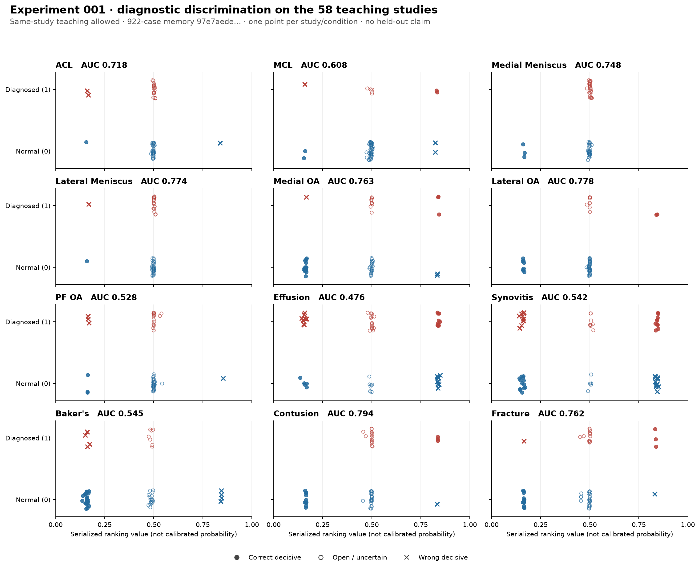
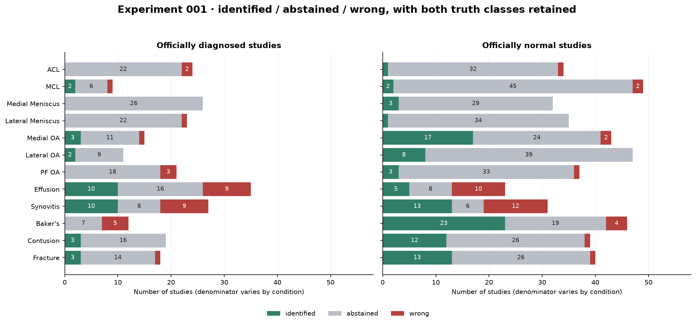

# Experiment 001 — first 58-study diagnostic readback

Recorded: 2026-10-22T16:11:24.492082-04:00 (America/New_York); 2026-10-22T20:11:24.492082+00:00 (UTC).
Investigation: local classical-AI bootstrap. Registration is retrospective, after the first run and its reported result. Gemini ran inference; Codex independently recounted saved outputs.

## Question and intervention

Can the running society use the reviewed visual teaching to discriminate the twelve labelled conditions on the 58 teaching studies? This is the first entry in this notebook, not a claim that no earlier development runs exist. The tested memory includes the earlier bootstrap, signed corrections and the latest visual teaching; the last review retained six useful positive presentations and six view-scoped negatives, including a sagittal-only PCL negative. The false-patella correction was preserved. Several changes precede this run, so their separate causal effects are not identified.

## Population and experimental design

58 distinct MRI studies selected by the existing `--labeled --root data/raw` route, with all twelve official numeric conditions present: 696 study-condition questions. The exact UID set, input record hashes and template reconciliation are retained in the machine result. There are no missing or extra template studies.

**This is teaching-set readback.** The entry point action is `infer`; all 58 exclusion records say `not_requested`. A study may speak through its own teaching. This is an appropriate bootstrap readback, but it is not a held-out accuracy estimate or a measurement of new-patient transfer. No new truth was inferred from the pipeline output.

Independent truth: the literal 0/1 cells in `data/raw/train.csv`, SHA-256 `8ca2203c0e9d61c080c7a314c7cdb51c1b03a1d9eb4770819f7f34af53ef4e33`. Its 58 evaluated rows have complete truth. Official 1 means expected present (+1); official 0 means expected absent (−1). A pipeline open answer remains uncertainty (0).

## Implementation, memory and execution

- Tested memory: `growth-batch-20/gemini-visual-reviewed-r2/memory`, **922 case records**, including configuration records; this is not a count of 922 independent patients or individually isolated anatomical objects.
- Memory manifest SHA-256: `97e7aede02eaf8953f6bc423a5693f74e67bcac7478d89550972fec9c639a63f`.
- Run: `data/readings/grounded-teaching-20261022/r4-all58-infer`.
- Run receipt SHA-256: `8f98e479c6eee38a7f4119fffc967cfda38d8fcf04b7774886410cf10722b58d`.
- Entry point: `scripts/run_interiors.py --labeled --root data/raw --workers 4 --diagnostic-mode infer --diagnostic-memory <the tested memory> --diagnostic-submission-template data/readings/lead-repair-20261021/cohort-real/all58-template.csv --diagnostic-output <the run directory>`.
- Submission SHA-256: `102fceb6ed9f725d9a47b0ea6d91975bd0fb9f965ae336a3df4cee2dbad60aaf`.
- Full execution code/environment pin: **not supplied by this run receipt**. Inspected analysis-source hashes are retained separately and are not represented as proven runtime source pins.
- A later 952-case clinical/procedure child already exists. **This entry does not measure that child.**

## Measured discrimination profile

Each count is identified / abstained / wrong. Ranking AUC is computed from the actual serialized submission values with exact decimal comparisons and half credit for exact ties. Values and their means are ranking readouts, not calibrated probabilities. No mean across conditions is used as the result.

| Condition | Positive n: I / A / W | Negative n: I / A / W | AUC | Mean ranking, positive | Mean ranking, negative | Difference |
|---|---:|---:|---:|---:|---:|---:|
| ACL | 24: 0 / 22 / 2 | 34: 1 / 32 / 1 | 0.718137 | 0.473173 | 0.497696 | -0.024524 |
| MCL | 9: 2 / 6 / 1 | 49: 2 / 45 / 2 | 0.607710 | 0.533003 | 0.494905 | +0.038098 |
| Medial Meniscus | 26: 0 / 26 / 0 | 32: 3 / 29 / 0 | 0.747596 | 0.500950 | 0.466790 | +0.034160 |
| Lateral Meniscus | 23: 0 / 22 / 1 | 35: 1 / 34 / 0 | 0.773913 | 0.487411 | 0.488453 | -0.001042 |
| Medial OA | 15: 3 / 11 / 1 | 43: 17 / 24 / 2 | 0.762791 | 0.545398 | 0.381425 | +0.163973 |
| Lateral OA | 11: 2 / 9 / 0 | 47: 8 / 39 / 0 | 0.777563 | 0.561139 | 0.441324 | +0.119815 |
| PF OA | 21: 0 / 18 / 3 | 37: 3 / 33 / 1 | 0.527671 | 0.456013 | 0.483122 | -0.027109 |
| Effusion | 35: 10 / 16 / 9 | 23: 5 / 8 / 10 | 0.475776 | 0.508424 | 0.570714 | -0.062290 |
| Synovitis | 27: 10 / 8 / 9 | 31: 13 / 6 / 12 | 0.542413 | 0.514339 | 0.488193 | +0.026146 |
| Baker's | 12: 0 / 7 / 5 | 46: 23 / 19 / 4 | 0.545290 | 0.351594 | 0.353367 | -0.001773 |
| Contusion | 19: 3 / 16 / 0 | 39: 12 / 26 / 1 | 0.794197 | 0.549492 | 0.403111 | +0.146381 |
| Fracture | 18: 3 / 14 / 1 | 40: 13 / 26 / 1 | 0.762500 | 0.532844 | 0.393877 | +0.138966 |

Correct decisive calls and ordering describe different properties. For example, ACL ordering is 0.718137 while only one decisive answer is correct; most questions remain open. Lateral OA has ten correct decisive answers and no wrong decisive answers in this readback, with 48 open answers. Both denominators matter.

## Distribution and decision figures

One point is one study/condition. Filled circles are correct decisive calls, hollow circles are
open answers, and crosses are wrong decisive calls. The two rows are independent official label
classes, not two inferred tissue states. [Vector version](figures/001-ranking-distributions.svg).

Counts retain both truth-class denominators. [Vector version](figures/001-ternary-outcomes.svg).

## Residual and interpretation

- Effusion: **15 identified, 24 abstained, 19 wrong**, comprising ten false positives and nine false negatives.
- Synovitis: **23 identified, 14 abstained, 21 wrong**, comprising twelve false positives and nine false negatives.
- Baker’s: **23 identified, 26 abstained, nine wrong**, comprising four false positives and five false negatives.
- Meniscal and ligament questions are predominantly unresolved. The exact row ledger retains which studies and which decisions these counts describe.

These are observations, not a diagnosis of the implementation defect. Native support, its named tissue, normal/condition precedents, opposing terms and actual named HDC differences must be inspected before teaching a correction. Fluid/synovial/bursal examples are a justified review priority; this run does not prove that an extra contrast bank is the solution.

The supplied report attributes correct negative decisions to negative censors. That causal attribution is not established by these outcomes alone. Censor/negative-case consumption can be traced in individual evidence, and a controlled comparison can isolate an effect when useful. The original report is retained verbatim rather than rewritten as primary measurement.

## Compute and completion

- All 58 requested studies have saved records; the template and submission cover exactly those studies.
- Receipt elapsed duration: **1012.483110 seconds** (16.87 minutes), four workers.
- Full-anatomy runs: **0**.
- Reported `peak_rss_bytes`: **7,432,372,224 bytes**. This is the receipt’s named measurement; it is not represented here as an independently sampled simultaneous whole-machine or combined-process peak.
- Persisted recall preparation was reused. This notebook did not rerun MRI processing to count the result.

## Change attributable to this iteration

No earlier entry in this notebook has a matching cohort, teaching relationship, truth source and implementation protocol. A paired improvement value is therefore **not yet available**. Earlier held-out or differently scoped measurements must not be subtracted from these teacher-readback results and called a learning gain. This entry establishes the first recorded discrimination profile.

Reviewed new material is published through one accepted memory chain. The next fresh SSD wave tests the later 952-case child. Its reports are read independently and uncertain or wrong image candidates will supply further teaching. Its fresh-study result will be reported as transfer, separate from any later readback of those same studies after they teach.

## Reproducible evidence

Measured JSON SHA-256: `9f849051520cfd22cc604d5b2e33c01557908d34e1be06ba2e75bb1bc0a33734`.\
696-row CSV SHA-256: `4cbfded7b1276cd56c019a0391f1802409b8b7844cecb570d0a0dd4f32aff278`.

- [Machine measurement and all source pins](../../../data/readings/grounded-teaching-20261022/growth-batch-20/teacher-readback-analysis-r1/iteration001-measured.json).
- [Reusable-recorder result, canonical input for later `--compare`](../../../data/readings/grounded-teaching-20261022/growth-batch-20/teacher-readback-analysis-r1/recorded-cli-report-r2/report.json), SHA-256 `173cee6ac63c8196b99147e686a3da9d436a6beb6e7a3ea5e5980de3252907fa`.
- [Real recorder self-control and source verification](../../../data/readings/grounded-teaching-20261022/growth-batch-20/teacher-readback-analysis-r1/recorder-final-validation-r2.json): 696 rows and all twelve self-comparison deltas zero; no new inference or teaching.
- [696-row exact study/condition ledger](../../../data/readings/grounded-teaching-20261022/growth-batch-20/teacher-readback-analysis-r1/iteration001-rows.csv).
- [Actual findings and object evidence](../../../data/readings/grounded-teaching-20261022/growth-batch-20/teacher-readback-analysis-r1/per-condition-ledger.json).
- [Complete official reports](../../../data/readings/grounded-teaching-20261022/growth-batch-20/teacher-readback-analysis-r1/complete-official-reports.json).
- [Residual diagnostic evidence](../../../data/readings/grounded-teaching-20261022/growth-batch-20/teacher-readback-analysis-r1/residual-evidence.json).
- [Proposed native-picture review targets](../../../data/readings/grounded-teaching-20261022/growth-batch-20/teacher-readback-analysis-r1/candidate-sheet-targets.json); these addresses are not certified tissue identities.
- [Original first-run report supplied by Rohan](../../../data/readings/grounded-teaching-20261022/growth-batch-20/teacher-readback-analysis-r1/original-first-run-report.txt), verbatim SHA-256 `0b746c3e745d8dc44467cc3210cb010dd18cd1ec175c1de681c830a56a3707e8`.

The separate run receipt, memory manifest and source records remain immutable at their original paths. This entry is a descriptive bootstrap research record, not a clinical validation claim.

## Addendum — native residual sheets, 2026-10-22

The bounded diagnostic review export produced nine native comparison sheets across three studies,
using the exact tested memory: [sheets, complete reports and selection record](../../../data/readings/grounded-teaching-20261022/growth-batch-20/teacher-readback-analysis-r1/visual-review-r1).
This adds review material, not new teaching calls or changed numerical results. The renderer reports
`banks_differ` for one fluid/synovium query bank in these examples, so those named-difference lists
remain unavailable; recess and bursa comparisons reproduce. Do not read missing difference rows as
evidence of no difference, and do not infer a production defect from the renderer result alone.

### Independent-truth discrepancy retained for adjudication

Study `1.2.826.0.1.3680043.8.498.10306159113324811538703788080836752052` has official numeric
**Effusion=0**, while its complete report's JOINT SPACE section explicitly states **“Small joint
effusion.”** Report SHA-256: `535c25b19ceaf6f7aae9dd8519943c4f04c38d4ade9e6b44416cd71888be4c42`.
The saved pipeline answer is assigned, so the numerical-label ledger correctly counts a false
positive. That scoring disagreement alone does not establish an incorrect anatomical fluid finding
or warrant teaching the opposite finding. The original numeric label, full report and model answer
remain separately attributed. No label was changed and no diagnosis case was silently corrected.
See the full report and exact selected error in the linked residual-sheet directory.
