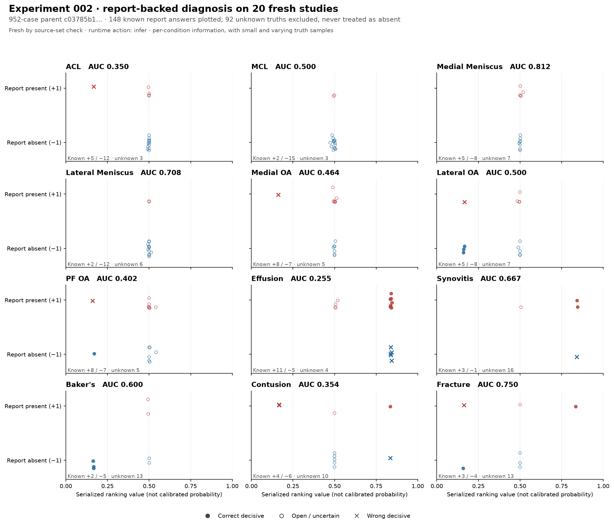
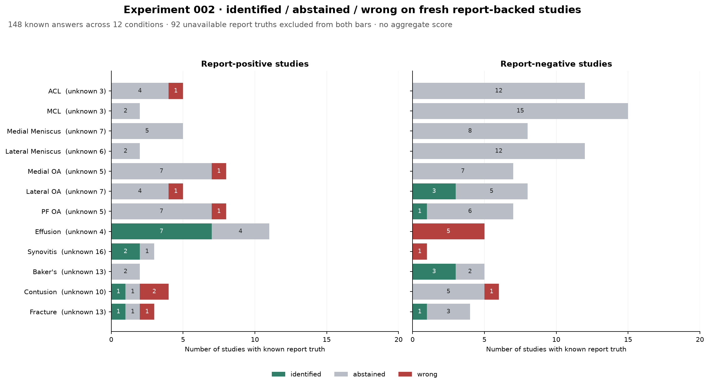

# Experiment 002 — next fresh SSD wave

Registered during inference: 2026-10-22T16:11:24.492082-04:00 (America/New_York).
Local inference began 2026-10-22T20:05:32.409846+00:00 (UTC). This is not a prospective preregistration.

## Question and intervention

What does the next frozen memory resolve on genuinely fresh MRI studies, and what observed
uncertainties and mistakes can teach its successor? The memory adds independently reviewed clinical
presentations/configurations and checked procedure experience to experiment 001's visual child.
This is a bundled learning intervention; no isolated causal effect is assumed.

## Inputs and teaching relationship

- Tested parent: `growth-batch-20/report-teaching/clinical-procedure-child-r2/memory`.
- Manifest SHA-256: `c03785b1501e7967f77941f464b655da466be1bfcb453b78fd7f678e52397036`.
- 952 case records and 361 checked procedure experiences; these are different record kinds.
- Immediate predecessor: experiment 001's 922-case visual memory, `97e7aede…`.
- Twenty studies chosen in lexicographic UID directory order, without consulting diagnosis labels.
- All 87 distinct teacher/prior-run UIDs excluded; exclusion includes signed identity, clinical/
  configuration and procedure teaching, and the prior twenty-study run. Blank ledger placeholders
  do not count as teaching. The exact provenance is retained in `teacher-exclusions.json`.
- 3,576 DICOMs, 2,295,047,836 bytes; every selected file passed the trusted ZIP inventory's expected
  size/CRC and current file SHA checks. No incomplete studies were accepted.
- Local ten and remote ten have disjoint exact UID lists. They read the same frozen parent and
  do not publish separate children.
- All 240 numeric condition cells are blank. Independently read reports can establish scoped truth;
  unmentioned and uncertain findings remain unavailable. Reports are not inference features.

## Execution and provenance

The declared execution code identity is
`8ea3ab53d6d4f3a1bf79025ea26056f0b75cab7aec963ce98b66ce0548e59f28`. The actual per-host launch record checks source, entry point,
parent and study inputs, and records the command and completion result. One native-math thread
per process prevents nested oversubscription. Local inference uses four study workers; the remote
lane is staged for two.

- [Input/readiness receipt](../../../data/readings/grounded-teaching-20261022/growth-batch-20/next-wave-inputs-r1/receipt.json).
- [Exact study UID list](../../../data/readings/grounded-teaching-20261022/growth-batch-20/next-wave-inputs-r1/all-uids.txt).
- [All-source exclusions](../../../data/readings/grounded-teaching-20261022/growth-batch-20/next-wave-inputs-r1/teacher-exclusions.json).
- [Execution source pin](../../../data/readings/grounded-teaching-20261022/growth-batch-20/next-wave-inputs-r1/source-code-identity.json).
- [Expected file inventory](../../../data/readings/grounded-teaching-20261022/growth-batch-20/next-wave-inputs-r1/source-inventory.json).
- [Measured file-content inventory](../../../data/readings/grounded-teaching-20261022/growth-batch-20/next-wave-inputs-r1/source-content-inventory.json).
- [Local launch record](../../../data/readings/grounded-teaching-20261022/growth-batch-20/next-wave-run-r1/local-launch.json).

## Results — state at registration

At registration, completion and independent report review were pending. The completed measurement
is recorded below under “Completed pre-teaching diagnostic measurement.” No fresh-study gain is
filled from the teaching-set result. Missing report truth is reported separately per question.

The raw predictions precede this batch's teaching. After image/report review, the one published
child will retain warranted positive/negative cases and useful procedure experience. Later
readback of these studies will be distinguished from transfer to the next fresh batch. A
same-cohort comparison, if run, will preserve truth and protocol and record exact row transitions.

## Deviations and completion addenda

Add the actual remote receipt, measured outcomes, teaching decisions, accepted child and any
failure/retry here after they exist. Active job ownership remains in FULL_BUILD_PLAN §13's packet.

### Local shard completion, 2026-10-22

All ten local studies completed through the real entry point, exit 0, in **170.146802 seconds**
including the launch wrapper's measured interval. Four study workers, one native-math thread per
process. The wrapper verified every pinned source digest and the memory manifest unchanged after
the run. This supplies observations; independent report/image teaching and diagnostic scoring are
separate operations. The actual command, study UIDs and exact times are in the linked local launch
record. The other ten studies must not be counted as complete until their own receipt is collected.

### Remote staging retry, 2026-10-22

The first remote attempt stopped before inference because staging omitted `test_series.csv` and
`test.csv`, which the existing both-split corpus loader requires even for a selected training shard.
Both small tables were copied, the both-split loader preflight passed, and the retry uses a fresh
`run-r2` path with the same source, parent and ten MRI inputs. The original failure and log remain
retained as `remote-attempt1`; the retry has its own launch record. This is a corrected staging
omission, not a change to the anatomical or learning rules.

### Remote shard completion, 2026-10-22

All ten remote studies completed and their outputs were collected back locally. The successful
retry ran in **151.11 seconds**, two study workers, reported peak RSS **5,590,499,328 bytes**,
zero full-anatomy runs. Source/environment, entry point, parent, selected image files and all four
metadata tables were rechecked unchanged. All twelve collected files match their remote hashes.
Run receipt SHA-256: `212d62eb4ac659094f0a0a17a34b52920ae75a413b690aab560490ab465a6c3d`.

- [Successful remote launch and preflight](../../../data/readings/grounded-teaching-20261022/growth-batch-20/next-wave-run-r1/remote-attempt2).
- [Collection verification](../../../data/readings/grounded-teaching-20261022/growth-batch-20/next-wave-run-r1/remote-collection.json).

The combined wave now contains twenty completed observations. Runtime figures are per shard;
they are not summed and called elapsed wall time. Diagnostic scoring awaits reviewed independent
report calls. Neither shard published a competing child memory.

### Candidate and report review material, 2026-10-22

Combined decisions-only analysis produced **674 candidates**: two automatically admission-eligible,
372 proposals, 240 opposed and 60 conflicts. This was analysis only; no child was published.
Opposition is not itself a verified negative identity. The original decisions and every unselected
candidate remain retained. Eighteen native sheets cover both eligible admissions plus sixteen
proposals in studies with independently reported Baker's/effusion and ligament injuries. These
proposals are teaching opportunities, not discarded merely because automatic recall abstained.

Root read all twenty complete primary reports and reviewed the 240 proposed condition calls.
The signed result has **58 positive, 90 negative and 92 unknown** calls, at study-condition scope.
All 240 validate against report hashes and exact quotations, with no rejected rows. Eight explicit
review corrections remain beside the original draft; no report certifies a candidate's tissue
identity or localizes a lesion by itself.

- [Combined candidate analysis](../../../data/readings/grounded-teaching-20261022/growth-batch-20/next-wave-run-r1/growth-analysis-summary.json).
- [Native-picture review index](../../../data/readings/grounded-teaching-20261022/growth-batch-20/next-wave-run-r1/selected-picture-sheets/index.md).
- [Reviewed independent report calls](../../../data/readings/grounded-teaching-20261022/growth-batch-20/next-wave-inputs-r1/report-teaching/reviewed-calls.json), SHA-256 `2522eb58a8190319ceb04270303ab329df435fb625efbed46b5688f8d4ff20bd`.
- [Review corrections and actual reader](../../../data/readings/grounded-teaching-20261022/growth-batch-20/next-wave-inputs-r1/report-teaching/REVIEWED-CALLS.md).

The resulting report-backed diagnostic measurement will retain all 92 unavailable truths. The
remote run did not request a submission CSV; any subsequent analytic serialization must use the
existing production writer, retain its source and record hashes, and be named as post-run
serialization rather than an original remote submission artifact.

## Completed pre-teaching diagnostic measurement

The following is a fresh-study measurement against independently reviewed report calls, before these twenty studies teach a child. It uses the frozen 952-case parent. There are 148 signed truths (58 positive, 90 negative) and 92 unavailable truths. All 240 final-finding/ranking/serialized-value bindings were checked. The unavailable truths are not counted as negatives or as diagnostic errors.

| Condition | Positive n: identified / open / wrong | Negative n: identified / open / wrong | Unknown truth | AUC | Mean ranking, positive / negative |
|---|---:|---:|---:|---:|---:|
| ACL | 5: 0 / 4 / 1 | 12: 0 / 12 / 0 | 3 | 0.350000 | 0.432320 / 0.498436 |
| MCL | 2: 0 / 2 / 0 | 15: 0 / 15 / 0 | 3 | 0.500000 | 0.496707 / 0.495095 |
| Medial Meniscus | 5: 0 / 5 / 0 | 8: 0 / 8 / 0 | 7 | 0.812500 | 0.506031 / 0.500055 |
| Lateral Meniscus | 2: 0 / 2 / 0 | 12: 0 / 12 / 0 | 6 | 0.708333 | 0.500519 / 0.499947 |
| Medial OA | 8: 0 / 7 / 1 | 7: 0 / 7 / 0 | 5 | 0.464286 | 0.458165 / 0.499538 |
| Lateral OA | 5: 0 / 4 / 1 | 8: 3 / 5 / 0 | 7 | 0.500000 | 0.428438 / 0.372071 |
| PF OA | 8: 0 / 7 / 1 | 7: 1 / 6 / 0 | 5 | 0.401786 | 0.462577 / 0.460155 |
| Effusion | 11: 7 / 4 / 0 | 5: 0 / 0 / 5 | 4 | 0.254545 | 0.718984 / 0.839388 |
| Synovitis | 3: 2 / 1 / 0 | 1: 0 / 0 / 1 | 16 | 0.666667 | 0.731613 / 0.841716 |
| Baker's | 2: 0 / 2 / 0 | 5: 3 / 2 / 0 | 13 | 0.600000 | 0.494545 / 0.300296 |
| Contusion | 4: 1 / 1 / 2 | 6: 0 / 5 / 1 | 10 | 0.354167 | 0.416966 / 0.555715 |
| Fracture | 3: 1 / 1 / 1 | 4: 1 / 3 / 0 | 13 | 0.750000 | 0.499575 / 0.414764 |

**Concrete residual:** all five report-negative effusions were called present. Synovitis has only one report-negative example here, and it was called present. These failures motivate inspection of the actual supports and normal-versus-altered precedents; no change to a numerical decision boundary is authorized by this table. Meniscal ranking can be informative even while categorical answers stay open. Small class counts, especially the single Synovitis negative, remain visible.

Each point is a known report answer; filled circles are correct decisive calls, hollow circles are
open, and crosses are wrong decisive calls. All92unavailable truths are excluded from both classes
and counted per condition. [Vector version](figures/002-ranking-distributions.svg).

Positive and negative denominators remain separate. [Vector version](figures/002-ternary-outcomes.svg).
The [reproducible generator and plot validation](../../../data/readings/grounded-teaching-20261022/growth-batch-20/next-wave-run-r1/notebook-measurement-r1)
pin the underlying240-row ledger and independently reconcile per-condition counts and exact AUC.

**Comparison scope:** experiment001 is teacher readback on 58 fully labelled studies; this entry is fresh transfer on twenty different studies with partial report-derived truth. Subtracting their AUCs would not measure the effect of adding thirty case records and 253 procedure experiences. No such gain or decline is claimed. The next accepted child and any same-cohort teaching readback must have their own entry and phase, followed by a further fresh batch.

- [Exact measured results and provenance](../../../data/readings/grounded-teaching-20261022/growth-batch-20/next-wave-run-r1/notebook-measurement-r1/measurement.json), SHA-256 `acf23509c1de43983a06dbff9abd01365ff01c24c06dda3f729dab028eb376ad`.
- [240-row ledger](../../../data/readings/grounded-teaching-20261022/growth-batch-20/next-wave-run-r1/notebook-measurement-r1/iteration002-rows.csv), SHA-256 `3c9ae7f034485aa8370267c232d589fc9ac6291f133f64d8a3eb222935d1f20c`.
- [Independent report-truth serialization and analytical method](../../../data/readings/grounded-teaching-20261022/growth-batch-20/next-wave-run-r1/notebook-measurement-r1). The report-derived CSV is not the official numeric label file. The remote ranking CSV was serialized after the run through the existing production writer; it was not an original remote-run artifact.

No new memory has been published by this measurement. Positive image teaching, scoped corrections and procedure retention remain separate, explicit operations.

## Subsequent teaching and accepted child, 2026-10-22

After the frozen pre-teaching measurement, root inspected six native candidate sheets. Five scoped
identity confirmations and one sagittal ACL-support rejection were retained through the existing
visual teaching operation. The rejection says the proposed support is anterior femoral/articular
tissue rather than the ACL course; it does not teach absence of the independently reported ACL
injury. Tibia's extra axial panel depicts femur and is excluded from its confirmed views, with the
role correction preserved separately rather than manufacturing an appearance censor between bones.
Useful rough and mixed supports are recorded as such; they are not claimed as perfect tissue masks.

The reviewed builder joined applicable independent report calls only to confirmed identity support,
rebuilt canonical configurations, and retained the actual checked procedure experiences. It published
one immutable child directly from the tested parent, then reloaded it and checked preservation.

| Memory component | Tested parent | Accepted child | Actual addition |
|---|---:|---:|---:|
| Case records, including configurations | 952 | 993 | 5 identity presentations + 4 clinical presentations + 32 configurations |
| Confirmed identity IDs | 247 | 252 | 5 |
| Scoped negative identity IDs | 345 | 346 | 1 |
| Retained checked procedure experiences | 361 | 650 | 289 |

Negative identity records live in their separate signed store and are not included again in the
993 case count. Configurations are not independent patients. The 240 reviewed report calls remain
58 positive,90 negative,92 unknown; eleven applicable signed calls joined four object presentations.
Study-condition scope is preserved: a contextual tibial presentation does not localize an ACL injury
inside tibial pixels. The necessary-tissue/configuration consumer contract remains in force.

The export supplied806procedure rows:289checked and517unchecked. Only the checked rows enter the
retained procedure store here; “checked” does not mean successful. Unchecked source experiences
remain in the original immutable export rather than becoming unsupported learning claims.

- Accepted memory: `next-wave-run-r1/reviewed-learning-child-r1/memory`.
- Manifest SHA-256: `ef68a24bda3643a9c4fd7a62969a99b11968ba87a4826279bcc60b2796b8c8a1`.
- Immediate parent: `c03785b1501e7967f77941f464b655da466be1bfcb453b78fd7f678e52397036`.
- [Actual publication/readback receipt](../../../data/readings/grounded-teaching-20261022/growth-batch-20/next-wave-run-r1/reviewed-learning-child-r1/receipt.json).
- [Reviewed six visual cases and original profiles](../../../data/readings/grounded-teaching-20261022/growth-batch-20/next-wave-run-r1/reviewed-visual-additions-r1).
- [Checked procedure export](../../../data/readings/grounded-teaching-20261022/growth-batch-20/next-wave-run-r1/checked-training-r1/receipt.json).
- [Reproducible single-publication builder](../../../data/readings/grounded-teaching-20261022/growth-batch-20/next-wave-run-r1/build-reviewed-child.py), SHA-256 `49522b2a9129800410de020d84b939718db149d81a90802a1b4be4660601d779`.

All952inherited cases are retained or explicitly versioned as superseded configurations; inherited
signed/full stores, known label cells, views and parent bytes passed preservation checks. No next
prediction has yet measured this993-case child's benefit. Forty further fresh studies are verified
and staged for a subsequent experiment; they have not supplied a result in this entry.
