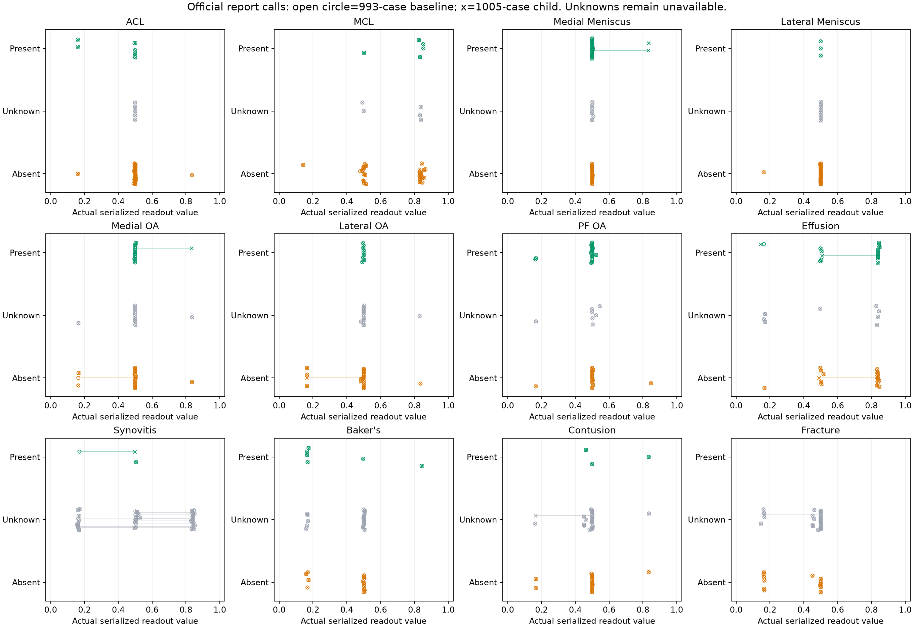
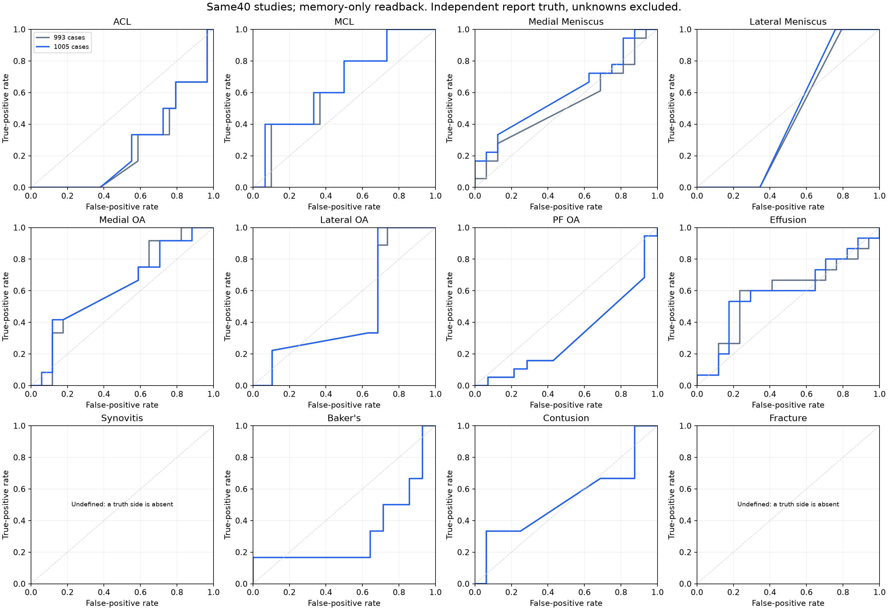

# Experiment 003 — does reviewed teaching change the next forty studies?

Recorded 2026-10-22, America/New_York. Investigator and final visual/report reviewer: Codex lead.
Native helpers staged pinned material, executed bounded shards and calculated measurements; their
proposals did not supply the author's intent or final clinical calls. This entry was written after
the paired results existed. It is not a prospectively registered experiment.

## Question and fixed comparison

Does the next reviewed child alter actual discrimination on a fresh cohort when raw studies,
implementation and readout stay fixed? This is the author's test → review → teach → try again loop,
with an added paired check. It tests the bundled memory intervention, not the isolated effect of
one case or a newly learned general rule.

- Baseline: **993 cases**, `ef68a24bda3643a9c4fd7a62969a99b11968ba87a4826279bcc60b2796b8c8a1`.
- Tested child: **1,005 cases**, `1feeee1d265f0eff30a61d3be31b323a59e4e10d91e6c98314d624f1a4993417`.
- Child intervention: six reviewed positive identities, five scoped negative identities, six
  clinical presentations and fifteen refreshed configurations. Refreshes are not fifteen new
  independent examples. All650 checked procedure experiences were unchanged in this intervention.
- Source epoch: `8ea3ab53d6d4f3a1bf79025ea26056f0b75cab7aec963ce98b66ce0548e59f28`.
- Same40 studies, original MRI bytes, two20-study shards, four workers and one native thread;
  same production entry point, writer and output adapter. Only memory/output locations changed.
- All40 supplied no teaching of any record kind to either frozen parent. All-source membership
  and input/source postflights are retained. No report truth entered inference.

This is fresh-study transfer under both parents. It is not teacher readback. Later teaching on
these forty studies will change their relationship to that later memory and will be named accordingly.
Twelve questions per patient, views of an object and correlated supports are not independent patients.

Population: [exact forty UIDs](../../../data/readings/grounded-teaching-20261022/growth-batch-20/following-wave-inputs-r1/all-uids.txt). Execution/input and all-source teacher evidence: [baseline index](../../../data/readings/grounded-teaching-20261022/growth-batch-20/following-wave-run-r1/combined-output-index.json), [tested-child binding](../../../data/readings/grounded-teaching-20261022/growth-batch-20/following-wave-run-r1/paired-child-infer/execution-parent-binding-r1.json) and [complete paired verification](../../../data/readings/grounded-teaching-20261022/growth-batch-20/following-wave-run-r1/paired-child-infer/paired-memory-only-comparison.json).

## Independent report teaching and review

Root read all40 complete official reports and reviewed all480 condition calls. There are312
signed calls:98 present and214 absent;168 remain unknown or unmentioned. The numeric label
cells for these studies are blank. These are report-backed research annotations, not newly
invented official competition labels. Report silence never teaches normality.

Ten draft adjudications are recorded rather than silently rewriting the extraction. Examples:
physiological joint fluid supplies a normal-fluid judgment; trace/minimal fluid alone does not
assert effusion; degenerative marrow edema alone does not assert traumatic contusion. A leaking
lesion in the explicitly named gastrocnemius-semimembranosus bursa supplies a clinically interpreted
Baker presentation at that site. That interpretation is attributed to the reviewer. Qualified or
internally conflicting assertions remain recorded, including a normal MCL with possible surface
strain edema. No study-wide clinical call identifies pixels in every implicated object.

Sources: [complete primary reports](../../../data/readings/grounded-teaching-20261022/growth-batch-20/following-wave-run-r1/report-teaching/FULL-REPORTS.md), [reviewed480 calls](../../../data/readings/grounded-teaching-20261022/growth-batch-20/following-wave-run-r1/report-teaching/reviewed-calls-r1.json) and [adjudication receipt](../../../data/readings/grounded-teaching-20261022/growth-batch-20/following-wave-run-r1/report-teaching/review-receipt-r1.json).

## Per-condition results

I/O/W means identified / open (abstained) / wrong, against the signed report calls only. Unknown
truth is shown separately and never included as a negative. AUC is exact pairwise ordering from
the actual serialized production CSV decimals, with half credit for ties; it is information about
behavior, not a target or a claim of calibrated patient probabilities. No aggregate score is used.

| Condition | Positive n | Negative n | Unknown | Positive I/O/W before → after | Negative I/O/W before → after | AUC before → after |
|---|---:|---:|---:|---|---|---|
| ACL | 6 | 29 | 5 | 0/4/2 → 0/4/2 | 1/27/1 → 1/27/1 | 7/29 (0.2414) → 89/348 (0.2557) |
| MCL | 5 | 30 | 5 | 4/1/0 → 4/1/0 | 1/14/15 → 1/14/15 | 16/25 (0.6400) → 33/50 (0.6600) |
| Medial Meniscus | 18 | 16 | 6 | 0/18/0 → 2/16/0 | 0/16/0 → 0/16/0 | 151/288 (0.5243) → 43/72 (0.5972) |
| Lateral Meniscus | 3 | 29 | 8 | 0/3/0 → 0/3/0 | 1/28/0 → 1/28/0 | 25/58 (0.4310) → 13/29 (0.4483) |
| Medial OA | 12 | 17 | 11 | 0/12/0 → 1/11/0 | 3/13/1 → 2/14/1 | 5/8 (0.6250) → 253/408 (0.6201) |
| Lateral OA | 9 | 19 | 12 | 0/9/0 → 0/9/0 | 3/15/1 → 4/14/1 | 9/19 (0.4737) → 82/171 (0.4795) |
| PF OA | 19 | 14 | 7 | 0/17/2 → 0/17/2 | 1/12/1 → 1/12/1 | 6/19 (0.3158) → 6/19 (0.3158) |
| Effusion | 15 | 17 | 8 | 10/4/1 → 9/5/1 | 1/5/11 → 1/6/10 | 149/255 (0.5843) → 151/255 (0.5922) |
| Synovitis | 2 | 0 | 38 | 0/1/1 → 0/2/0 | 0/0/0 → 0/0/0 | no negative truth → no negative truth |
| Baker's | 6 | 14 | 20 | 1/1/4 → 1/1/4 | 4/10/0 → 4/10/0 | 9/28 (0.3214) → 9/28 (0.3214) |
| Contusion | 3 | 16 | 21 | 1/2/0 → 1/2/0 | 2/13/1 → 2/13/1 | 17/32 (0.5312) → 17/32 (0.5312) |
| Fracture | 0 | 13 | 27 | 0/0/0 → 0/0/0 | 6/7/0 → 6/7/0 | no positive truth → no positive truth |

The two figures show the same actual480 comparisons. An unknown report call can show a changed
output but cannot establish that the change was clinically right. Synovitis has no signed negative
truth here; fracture has no signed positive truth. Their AUCs are therefore undefined, not zero.

## What actually changed

- Medial meniscus: two previously open positive cases became correctly present.
- Lateral OA: one previously open negative became correctly absent.
- Synovitis: one wrong absence became open; other new assignments mostly lack signed truth here.
- Medial OA: one positive became correctly present, while one correct negative became open.
- Effusion: one false positive became open, while one correct positive also became open.
- Other signed categorical results were unchanged, though some ranking values changed.

The intervention therefore has observable benefits and losses. It does not establish uniformly
better diagnosis. MCL still has15 false positives among30 report-negative studies; Effusion has10
among17. These are concrete residuals for image/context interpretation and further teaching, not
reasons to soften a band or optimize a threshold. The row ledger retains exactly which studies,
source sentences, original values, balanced-ternary findings and changes produced these counts.

Complete analysis: [machine-readable measurement](../../../data/readings/grounded-teaching-20261022/growth-batch-20/following-wave-run-r1/paired-child-infer/notebook-measurement-r1/measurement.json), [all480 annotated paired rows](../../../data/readings/grounded-teaching-20261022/growth-batch-20/following-wave-run-r1/paired-child-infer/notebook-measurement-r1/iteration003-paired-rows.csv), [measurement table and exact ties](../../../data/readings/grounded-teaching-20261022/growth-batch-20/following-wave-run-r1/paired-child-infer/notebook-measurement-r1/SUMMARY.md).

## Visual teaching carried forward on the single chain

While the comparison ran, root inspected all34 strongest unresolved category sheets,56 native
panels. The next publication retained12 positive identity calls and13 scoped negative calls, with
ten inspected unknowns retained separately. The patellar-tendon case is positive in one sagittal
facet and negative in another, with both records linked to the same measured source; they are not
two independent examples. Useful rough cartilaginous/tendinous supports were accepted without a
perfect boundary requirement. Incorrect proposed roles retain their actual scope and measurements.

The published continuation has **1,061 cases**,270 confirmed identity IDs,364 negative identity
IDs and650 unchanged checked procedure experiences. It directly extends the1,005-case child:
`ccd01612d36eae5a25a73c03a6937fc44ad9317e8390a71d13beac5c55d23da8`.
It adds seven clinical presentations and rebuilds configurations for seven affected studies using
the previously reviewed, matching20-study reports. It does not insert the new40 reports blindly
onto unconfirmed supports. All inherited cases remain present or explicitly superseded; signed
stores, full-profile payloads, actual view scopes and immediate-parent lineage passed readback.
This1,061-case continuation was NOT the tested memory in the paired table above.

Original joint signal patterns, opposing assertions and contextual interpretations stay linked by
digest. Existing HDC and signed-case consumers use the measured presentations. This publication does
not install or demonstrate automatic learning of a generalized disagreement interpretation, censor
or split. That is a separate agency-learning operation, not proved by retaining an explanation.

Reviewed sheets: [category packet](../../../data/readings/grounded-teaching-20261022/growth-batch-20/next-wave-run-r1/category-review-r2/exclusions-r2/index.md). Publication/readback: [1,061-case receipt](../../../data/readings/grounded-teaching-20261022/growth-batch-20/next-wave-run-r1/category-review-r3/published-learning-child-r1/receipt.json).

## Compute, deviations and verification

Both forty-study passes completed with zero full-anatomy runs. Baseline shard elapsed times were
317.363s and454.501s; tested-child shards341.516s and330.845s. They ran sequentially per pass.
Recorded peaks by shard were approximately5.52/6.91GB and6.06/9.08GB. These are the run's reported
RSS measurements, not summed fleet memory or controlled performance gains. Preparation and actual
per-shard receipts remain linked in the paired verification record.

The planned remote copy was stopped at the owned staging process after measured transfer cost
made local bounded inference faster to finish. No remote inference had started; the partial copy
and failed staging receipt were retained. Four Claude Max draft requests returned the weekly limit
with zero tokens. Native readers continued the mechanical draft; root made final clinical calls.
No paid-API fallback, repeated billed request, Kaggle run or full CI gate was performed.

The existing report importer validated all480 final calls, including verbatim source quotes,
source digests and unresolved states. Both inference postflights and comparison schema/value checks
passed. The direct visual publisher validated both signs and ordinary immutable-child readback.
These are scoped checks, not a new full-project certification.

## Supported conclusion and next iteration

### Actual precedent-to-action traces

The [two-case consumer trace](../../../data/readings/grounded-teaching-20261022/growth-batch-20/following-wave-run-r1/paired-child-infer/notebook-measurement-r1/bounded-effects-summary.json)
links the two newly correct meniscus answers to their real consumers. Study `…604738314` changes
its necessary-tissue reading from unknown to warranted positive through new presentation
`case-sha256:1011e7cc…`; study `…628828930` changes through the covered positive configuration
from teaching study `…185417806`. Neither query taught the frozen child.

Actual ordered observation sequences also differ. The first study executes22 measured looks
instead of20, including a newly contested joint-fluid identity look and an effusion-recess look.
The second still executes20, with the meniscus look now attributed to a remaining OA question.
Shared-observation reuse is recorded separately from newly measured looks. This demonstrates
memory changing diagnostic and observation behavior, not automatic learning of the root's
textual interpretation or an isolated causal benefit from procedure-memory updates (the650
procedure records were unchanged).

The same trace shows the first study's fibula moving from structural-reader established/eligible
to contested/withheld after recall. That is a recorded change, not a demonstrated correct veto.
Its actual support, contradiction and scope need examination before attributing anatomical
validity to that change; an appearance-only other-bone name cannot erase established anatomy.

Reviewed teaching already changes decisions on genuinely new studies; some changes are correct,
some reduce justified certainty, and serious residuals remain. The evidence supports continued
case/procedure learning with the existing agencies. It does not establish complete diagnosis or
completion of every designed Society of Mind learning operation.

Continue from the1,061-case tip, inspect the strongest remaining unresolved/conflicting native
presentations—including the MCL/effusion false-positive patterns—and teach their contextual
meaning without deleting disagreeing measurements. Save the next immutable child and distinguish
its teacher readback from another fresh transfer check. Generalized censor/split and interpretation
learning must name their actual update and consuming agency; retaining a corpus is not the entire
AI training algorithm. Current scheduling remains only in FULL_BUILD_PLAN §13's packet.
