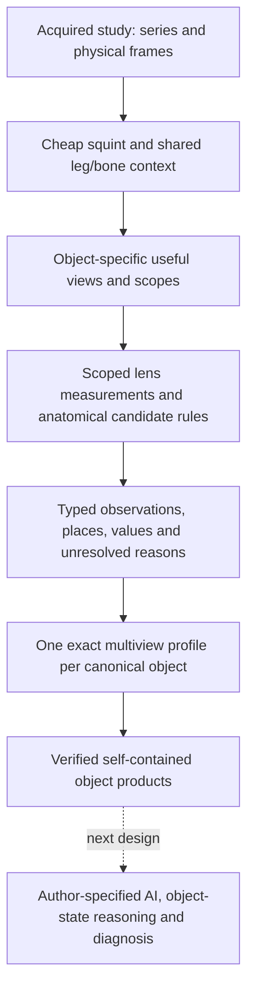

# Seeing a knee as objects

**An illustrated argument from acquired images to anatomical candidates and exact object bundles.**

This packet demonstrates the pre-AI operation of RSNA_Knee. Its subject is the mechanism: how simple, scoped measurements, interpreted through the physical relations of knee anatomy, produce useful object candidates; how their original places and measurements survive; and how those observations become one exact, multiview representation per object. The paper describes the broader classical-AI design; the knee-specific AI, diagnosis and training mechanisms remain the author's next design discussion.

The primary theory is [*What an <Object> Is*](../../cell_tracking/docs/pipeline_thesis/paper/what_an_object_is.md), especially §§1.5, 2, 4, 7, 8 and 13. The knee-specific interpretation is [THEORY_OF_THE_CASE](THEORY_OF_THE_CASE.md), with the author's [original conversation](conversations/2026-10-13-the-thesis.md) and [structural-information/HDC clarification](conversations/2026-10-19-structural-information-and-exact-hdc.md). This packet follows those sources; it supplies an illustrated evidence trail rather than a replacement theory.

## 1. The claim to demonstrate

A knee image is a measurement of a physical thing with parts. Its parts have boundaries, material properties, attachments and spatial relations. They are not arbitrary arrangements of pixels. A bone's interior, its enclosing cortex, a tendon approaching its attachment, and fluid in an articular space constrain one another's interpretation.

The pipeline uses that structure directly. It does not ask one scalar to mean “meniscus” or one dark component to mean “tendon.” It obtains separate readings, restricts them to anatomically meaningful places, and combines the relevant sets and relations. A candidate can then be explained in terms a person can inspect: **this dark structure, in this place, with these neighbours and this continuity, is a candidate for this object.**

This is the computer-vision claim: the output describes objects and their relations, with the visual evidence that warrants those descriptions. A useful candidate establishes capacity even when its border needs later refinement. An unread view or an imperfect candidate is retained as such, rather than being converted into an absent object or used to demand a new rule for every study.

The evidence has three different roles:

| Evidence | What it establishes |
|---|---|
| Acquired image beside lens/support panels | The visible structure, what the measurement selected, and whether the anatomical reading is reasonable |
| Addressed output records and retained arrays | Which places the actual operation supplied, their source, measurement type and unresolved states |
| Exact carrier/count arithmetic and readback | That the declared rows, counts and original retained values survive representation and storage |

A passing software test does not inspect an anatomical border. A plausible overlay does not establish exact serialization. Both parts are shown separately.

## 2. What a lens says

The author's thermometer example is the governing distinction. A thermometer reads temperature at its sensor. Calling that core body temperature, then calling it fever, requires additional structure and inference. In the same way, a low-signal lens identifies places satisfying its stated darkness measurement. It does not know which of those places are background, cortex, tendon, ligament or meniscus.

That limited scope is useful. Several incomplete readings can each contribute a different fact about the same physical object. Their intersection, exclusion, enclosure, contact and continuity can resolve a description that none carries alone. No single lens is required to supply a complete anatomical identity.

**Figure 1 — The original sagittal proof example, dated 2026-10-15.** The left panel is the acquired slice; the middle marks the low-signal reading; the right overlays the early anatomical assignments. The lens marks exterior darkness as well as dark structures in the leg. The anatomical reading additionally uses the patella and the anterior structures above and below it, the adjacent bone, and their visible arrangement. The drawing contains coarse and imperfect assignments; its point is that the relevant structures are already exposed by simple measurements. This is historical visual evidence, not a picture generated by the later integrated H5 run.

Reading a lens numerically as an unstructured pile of components hides what these images make apparent: the measured sets already expose recognizable physical borders. That is a visual observation about these examples; the lens itself assigns no anatomical meaning. Looking at the images is part of establishing the rule's validity, not optional decoration after a numerical score.

### Worked visual argument: the anterior recess and its lining

The bright pocket behind the patella in Figure 1 supplies a particularly short derivation. The [recorded rule](RESOLVING_THE_PARTS.md#anterior-synovial-recess-and-synovial-lining-surface) proceeds as follows:

1. On a fluid-sensitive, fat-suppressed sagittal view, obtain the already named femur and patella and the independent white-fluid measurement.
2. Locate the anatomical place behind the patella, in front of the femur and above the patella's lower end, excluding named solid structures there.
3. Read the connected white bodies intersecting that place. The largest eligible whole body supplies the local anterior recess candidate.
4. Its anterior cavity boundary localizes the lining against the fat. This is a cavity-facing surface reading; it does not measure membrane thickness.

The white lens alone cannot distinguish every fluid-containing pocket in the leg. The named neighbours alone supply no fluid boundary. Together they supply a sensible cavity candidate and a distinct lining location. The saved recess and lining masks coexist with the earlier tissue labels; one label is not forced to erase the others. Missing prerequisites produce named refusals.

The rule also illustrates why reuse matters. It reads the existing white measurement directly rather than demanding that an earlier final fluid label already include this pocket. A prematurely narrowed interpretation would throw away usable evidence that the measured lens still holds.

## 3. Anatomy supplies information to the local question

The paper's §1.5 makes the mechanism explicit. Under a model that holds the domain's laws, information about other parts can lower the uncertainty about a part:

\[
H(X\mid S)\le H(X).
\]

Here the surrounding anatomy is not an unrelated search hint. The relations help constitute the object being described. A candidate's location within an independently found bone is different evidence from the same signal outside it. A structure between particular articular neighbours is different from a similar-looking patch elsewhere. These distinctions must survive in the representation and its provenance.

The same section's Monty Hall example explains why lineage matters. The two closed doors look alike, but their roles in the constrained process differ. Likewise, native evidence, identity laid from a paired sequence, and a projected search location must not become interchangeable merely because their coordinates are close.

**Figure 2 — A small posterior tendon candidate in the original 2026-10-15 proof.** The low-signal panel includes several structures. The brown outline names a particular enclosed dark region in its anatomical context. “Dark” alone does not name the tendon; the local shape and arrangement support the assignment. The outlined region is visibly more specific than the whole low-signal set. This is a demonstration of the form of reasoning, not a claim that this one picture proves the rule's accuracy on every study.

The current object catalogue and resolution record supply the corresponding family-specific definitions: [OBJECTS_AND_CONDITIONS](OBJECTS_AND_CONDITIONS.md) and [RESOLVING_THE_PARTS](RESOLVING_THE_PARTS.md). Their anatomical statements and the measured satisfaction of those statements are different records. An authored attachment relation is not itself evidence that an attachment was measured in this scan.

The following is a reading guide to those definitions, not a new set of selectors. Each row identifies the extra information that a signal-only description would discard.

| Object family | What makes the local reading an anatomical candidate |
|---|---|
| Femur, tibia, patella and fibula | Coherent bone regions, their enclosing low-signal boundaries and acquisition-dependent interiors, and their different positions in the knee |
| Marrow associated with each bone | An interior reading belonging to a named bone; similar fat signal elsewhere does not supply that relation |
| Medial and lateral menisci | Dark wedge-like structures in the corresponding compartments between the condyle and plateau, with different sides, horns and body geometry |
| Femoral, tibial, patellar and trochlear cartilage | Surface-layer readings belonging to the relevant articular bone surface, rather than arbitrary bright tissue nearby |
| ACL and PCL | Different courses through the notch and relations to their femoral/tibial attachments; “dark ligament” alone does not discriminate them |
| MCL and LCL | Different sides and endpoints: medial femur/tibia versus lateral femur/fibular head; unavailable bone context is different from an independently measured conflict |
| Joint, joint fluid, anterior recess, lining and capsule | Interior space, fluid, cavity-facing lining and outer wall are different descriptions of related places, not alternative names for one bright patch |
| Extensor tendons and patellar retinacula | Tendons above/below the patella and bands beside it, interpreted relative to the patella, tibia and adjacent cavity |
| Hoffa, quadriceps and prefemoral fat pads | Fat-like tissue in different places around the tendon, patella and suprapatellar cavity; the combined suprapatellar entry remains distinct from its separated pads |
| Posterior gastrocnemius heads, tendons and bursa | Side, depth and neighbour relations distinguish muscle bellies, dark tendon cross-sections and the intervening fluid-containing bursa |
| Popliteal artery and vein | Measured lumen candidates and their relative posterior ordering; a lumen support or physical trace is not a complete vessel volume |
| Popliteus, iliotibial band and biceps femoris tendon | Distinct relations to the lateral femur, superficial fat and fibular head; their locally confluent or uncertain parts remain scoped |
| Gracilis, semitendinosus, semimembranosus and sartorius | The actual tissue and ordering at the slice's anatomical level, rather than substituting the distal tendon insertion order for a different level |
| Air, skin, subcutaneous fat and remaining muscle | Exterior/leg contact and residual tissue fields supply shared context; generic muscle is not a segmentation of every named muscle |

The original `meniscus` entry is also retained as a legacy unsided identity; the sided menisci must not be counted as evidence that it has a separate observed body. Likewise, marrow is retained as an associated field rather than invented as another independently coded bone.

## 4. Coarse structure makes both seeing and computation cheaper

The first question can be inexpensive: where is the leg, where are its large bones, and which slices show the relevant structure? A useful prior need not be a perfect skin boundary or a finished segmentation. It must retain a useful place to ask the next question, with its uncertainty and scope.

**Figure 3 — The original coronal block example, dated 2026-10-14.** The cyan box identifies the inspected part of each acquired slice. The following panels expose low signal, connected regions and borders in that block. The fibular region is visually recognizable without analysing every pixel of every series with every expensive operation. Slice 20 and slice 22 need not produce identical partitions: each is a separate reading of the same physical neighbourhood.

The production strategy follows that logic:

1. Read cheap, shared evidence about the series and leg.
2. Find each object's useful view through the squint and anatomical context.
3. Apply the relevant fine measurements within that useful scope.
4. Hand the measured values to every valid consumer instead of recomputing them.
5. Encode the retained object observations, publish them, and release consumed study intermediates after verified readback.

This connection is foundational. An anatomy-respecting scope removes places and interpretations the question need not pay to examine. Reusing the already resolved neighbours removes repeated inference. Exact sparse count storage avoids writing 512 dense numbers for every pixel and bank. These are consequences of representing the actual structured problem; the resource measurements in §10 establish only the cost of the measured implementations.

## 5. Three views describe one object

An anatomical object has separately useful sagittal, coronal and axial key slices. Each selected plane constrains one aspect of its physical location. Where all three independent planes are available, their intersection gives the object's reference in patient coordinates. **It is not the centre of the object's largest two-dimensional section.** A partial set of planes remains partial.

That reference directs search and directional encoding. It is not a measured tissue voxel and does not reconstruct the object's volume. Nor does adding pixels observed in several acquisitions measure additional physical tissue: acquisitions can overlap.

The actual output preserves:

| Record | Meaning |
|---|---|
| Native resolved support | The view's own rule supplied this candidate support |
| Native reading | A scoped measurement, which may be a mask, coarse grid, sample set or trace |
| Laid support | Identity transferred at corresponding physical places from a paired acquisition |
| Projected target | A physical location at which another native question can be asked |
| Unresolved code | What could not be said, and why; it is not an absence finding |

All available observations contribute to **one canonical object profile**, while view, sequence, lens, direction and measurement scale remain separate facets. The study's object reference uses the existing anatomical axes and their retained precision. A missing side, frame or reference leaves the affected directional facet unread. It is not replaced with a guessed origin or measured scale.

This diagram summarizes the data flow. It is not a measured trace of every function. The shared measurements and anatomical context are reused throughout the operation; the arrows do not require independent recomputation for each object.

## 6. From places to an exact profile

The paper's central encoding statement is simple: **an object's profile is the bundle of its places.** A place keeps its measured values, source address and row assignments. A bank names a kind of information. Within a bank, each possible declared reading has a distinct row.

For a numeric measurement with an explicitly supplied reference interval \([l,h]\), the digit is

\[
d(x)=\begin{cases}-1&x<l\\0&l\le x\le h\\+1&x>h.\end{cases}
\]

The original value remains beside that reduced reading. A measured middle writes the row for `0`. A missing reference or unread measurement writes no row and keeps its reason. Below and above use distinct rows, so they cannot cancel each other into a false normality.

The cell implementation in the paper obtains its own static middles from its stated movie-domain procedure. The knee's clinical healthy reference must follow its own source-backed anatomical/acquisition contract. This implementation does not silently turn study percentiles into healthy MRI norms. Qualitative words, producer status and authored definitions can be encoded where supplied; an unsupported numeric norm remains `missing_reference`.

For one bank, let \(h_i\) be its 512-wide Hadamard row and \(c_i\) the number of retained writings of that row. Then

\[
v=\sum_i c_i h_i,\qquad h_i\cdot h_j=512\,\delta_{ij},\qquad c_i=\frac{v\cdot h_i}{512}.
\]

Counts and vectors are exactly interconvertible under the declared carrier. Bank dimensions are disjoint. A bundle of bundles adds the same counts; order does not change the result. Subtraction is exact when the removed counts are present, and underflow is a named failure. The production carrier evaluates the same Sylvester transform through exact butterfly stages; it does not substitute approximate random vectors.

The multiview composer retains each exact source/place/facet/metric event once, preserving all its links. Conflicting codes for the same event remain a named conflict. Repeating a pointer does not create another measurement vote. Direction and scale qualify the observations without erasing their native coordinates.

## 7. Comparison preserves named differences

For two bundles with counts \(c_i\) and \(e_i\), orthogonality gives

\[
v\cdot w=512\sum_i c_i e_i,\qquad \|v\|^2=512\sum_i c_i^2.
\]

The count tables therefore supply the vector cosine exactly. A question names its banks in advance; one comparison jointly reads those selected banks spoken by both sides. A silent bank is left out of the dot product and both norms. The operation is not an average of independently scored banks. Rational-level and nearer-pair decisions use widened integer products, with named results for silence, ties, malformed inputs and incompatible identities.

The exact decode can name where two profiles differ: which view, bank and reading has more or fewer places. It does not make a cosine itself an anatomical or diagnostic verdict. That interpretation belongs to the structure and the later question-specific reasoning.

See the implementation contracts in [HDC_ENCODING](HDC_ENCODING.md), and the actual arithmetic in [`carrier.py`](../src/knee/encoding/carrier.py) and [`counts.py`](../src/knee/encoding/counts.py).

## 8. Why diagnosis follows naturally

The recognition output supplies a clean starting question: **what state is this identified object in?** In the author's design, a defined normal anatomical state and a signed deviation from it share the same structured language. The knee-specific healthy reference must be supplied where it is not yet defined. A departure in continuity, extent, appearance or relation can then be retained as a named difference rather than buried in an unexplained final score.

That is the bridge, not a diagnosis demonstrated by this packet. A real diagnostic claim still needs its defined condition, relevant measured banks, an appropriate healthy/reference contract, and the author's later decision mechanism. For example, larger measured extent is a size reading; whether it is inflammation requires the additional object- and acquisition-specific interpretation. No illustrative altered image or synthetic clinical label is used here as evidence of diagnosis.

The current outputs preserve the object places, original measurements, geometry and relations so that the later consumer can ask those questions without repeating recognition. They emit no invented diagnostic probability.

The competition's condition/object crosswalk already gives that later stage bounded questions. For example, the two meniscus labels concern the corresponding meniscus and compartment; the three OA labels concern particular articular compartments and their surfaces; effusion concerns joint fluid and its cavity; Baker's concerns the posterior bursa and its neighbours; and contusion/fracture concern bone and its interior. The complete twelve-label definitions and their source attributions remain in [OBJECTS_AND_CONDITIONS §§5–6](OBJECTS_AND_CONDITIONS.md#5-the-twelve-conditions). This is an object-to-question map, not an implemented diagnostic decision table.

## 9. Why these bundles are the substrate for K-lines

The paper's §8 describes a confirmed case as a bundle plus its confirmed role, what was expected and how it departed, and its independent source. Kept whole, the case preserves what occurred together. Recalling it over the relevant banks can reactivate an interpretation and the procedure that interpretation calls for. Confirmed negative departures can supply censors; an unanswered or refused question does not become negative teaching.

The current knee build supplies the object-bundle substrate: places and source links, typed multiscale facets, exact bundles and comparisons, and retained missing/conflicting states. A confirmed case additionally needs the call, expectation/departure and independent confirmation source just described. The build does not yet install the author's knee-specific case memories, agency decisions, diagnostic policy or training process. The present live composition is serialized before the operation returns. The saved product can be read without recognizing or composing the study again; the future in-memory AI consumer remains to be wired when its mechanism is supplied.

**Figure 4 — The author's H2b example from the cell project.** It illustrates how one object can hold readings at several scales, with full and cheap sources distinguished and unread banks left visibly unwritten. It explains the representation; it is not evidence of MRI recognition or a knee-specific bank catalogue. The knee implementation derives its patient-frame/view/scale facets from its own domain instead of copying the cell's eight directions and four rings.

## 10. Evidence scope and reproduction

The packet separates original proof pictures from retained integrated products. The original images above are dated development evidence. The integrated evidence copy is under [`data/readings/visual-proof-20261020`](../data/readings/visual-proof-20261020/); [`copied-evidence.json`](../data/readings/visual-proof-20261020/copied-evidence.json) pins every copied product and run record by source path, byte count and SHA-256. The copies are byte-identical to the completed `attempt9-proof2-corrected` run. That source epoch precedes the final CLI/error-path guards; these products are not relabelled as a fresh run of the final tree.

Two study products supply the integrated examples: the proof UID ending `...20594649149` and the bursa UID ending `...27729200903`. Their complete UIDs are in the evidence manifest. The products use the same public reader as downstream code. Support addressing must follow its declared type: a labelled map, mask row, coarse block, native sample and physical trace are different things. A marker is not displayed as a finished muscle boundary, and a projected target is not displayed as native recognition.

The schema contains 44 nonzero coded identities, including air, plus the code-zero `unassigned` value. Both products contain 44 canonical composition entries and 45 source-table entries: the latter retain an additional uncoded `recess` entry, while `unassigned` has no saved object entry. Table presence is not a claim of successful recognition. Stored composition statuses are 42 `partial` and 2 `silent` in the proof product, and 18 `partial` and 26 `silent` in the bursa product. These are encoding availability states, not accuracy percentages. The per-object evidence appendix keeps the actual observations and unresolved states separately.

The completed two-study serial/parallel comparison established equality across 42,394 retained arrays and normalized receipt/manifest semantics for its pinned source. The final integrated-source unit suite separately recorded 2,682 passing tests. Neither result establishes universal anatomical accuracy, final release-gate completion or hidden competition capacity.

The separate source-pinned offline Linux two-worker proof recorded 216.7603 seconds elapsed, 402.990704 CPU seconds and a cgroup memory peak of 4,346,728,448 bytes, with no OOM or swap. It ran emulated amd64 on Apple ARM with four CPUs and a local 12 GB memory cap. These are workload measurements, not competition-hardware timings or a projection that the nine-hour envelope is proved. Complete-cohort, final-source capacity/storage and release verification remain deferred at the author's chosen boundary.

The normal production entry point remains `.venv/bin/python scripts/run_interiors.py`. Drawing is optional and off by default; proof figures do not become competition-path work. Complete object outputs and necessary provenance remain retained, while this run's consumed intermediates are released only after successful public readback. The forthcoming engineering/run-guide documentation will give the full setup and command catalogue; this packet concentrates on the visual and representational argument.

## 11. What remains to establish

The pre-AI mechanism can be inspected now. This packet does not need perfect borders on every study to explain it. Its remaining evidence obligations are concrete: show each retained candidate at its actual scope; keep weak, missing and coarse observations visible; and distinguish an authored anatomical relation from a relation measured in a scan.

Unsupported numeric healthy profiles remain explicit inputs. The knee-specific AI, diagnosis and teaching mechanisms remain the next design discussion. A universal segmentation claim, a clinical-performance claim and full hidden-scale competition fit are not asserted by the demonstrated pre-AI substrate.
